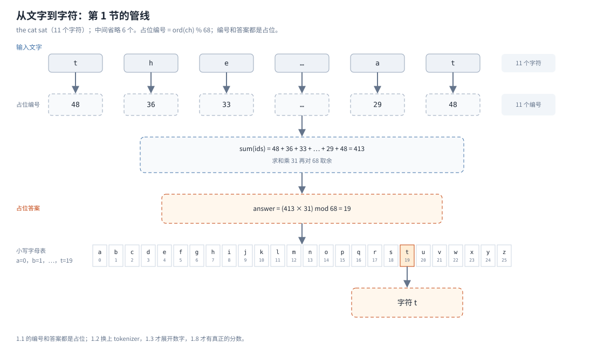

# 1.1 起点与本章交付物

本章要写的程序很小：给它一小段文字，它算出“下一个字符最可能是谁”。这一节先把整条链路跑通：文字变成编号，再直接给出一个占位答案。这个答案不展开成数字；数字在 1.3 才出现，真正的分数和答案在 1.7。

## 固定示例

后面每节都用同一个输入：`the cat sat`（11 个字符）。每节末尾打印同一组东西：编号、答案编号和它换成的字符。1.3 会把答案展开成每个位置的数字，1.7 才用真正的分数算出答案。

## 本节需要实现的函数

这一节只有一个模块：`src/llm101/placeholder.py`。1.1 只用到它的占位部分，不会加载后面的代码；后面每节会改它，直到完整模型接手后删掉。

### `_placeholder_ids`

`run` 的第一步会调用它：把一段文字变成占位编号。

对第 $t$ 个字符，取它的 Unicode 编码再对 68 取余：$ids[t] = \mathrm{ord}(\mathrm{text}[t]) \bmod 68$。

输入是 `str`，输出是 `list[int]`，长度等于字符数。

```text
>>> _placeholder_ids("ab")
[29, 30]
```

```python
def _placeholder_ids(text: str) -> list[int]:
    # 每个字符：ord(ch) % 68；输出长度等于字符数
    ...
```

### `_placeholder_answer`

`run` 的第二步会调用它：把编号列表直接变成一个占位答案。这一步不展开成向量；向量在 1.3 才出现。

规则很简单：把编号求和，乘 31，再对 68 取余。

输入是 `list[int]`；输出是 `int`，0–67。

```text
>>> _placeholder_answer([29, 30])
61
```

```python
def _placeholder_answer(ids: list[int]) -> int:
    # sum(ids) * 31 % 68
    ...
```

### `_placeholder_character`

`run` 的最后一步：把答案编号换成字符。占位规则是查小写字母表：`ALPHABET = "abcdefghijklmnopqrstuvwxyz"`，取 `ALPHABET[answer % 26]`。

输入是 `int`；输出是长度为 1 的 `str`。

```text
>>> _placeholder_character(61)
'j'
```

```python
def _placeholder_character(answer: int) -> str:
    # ALPHABET[answer % 26]
    ...
```

### `run`

把上面三个函数串起来，返回一个 `PipelineResult`：先计算 `ids`，再计算 `answer`，最后计算 `character`。

输入是 `str`，输出是 `PipelineResult`。1.1 不使用 `stage` 分支；后面的小节会用到它。

```text
>>> result = run("ab")
>>> result.ids
[29, 30]
>>> result.answer
61
>>> result.character
'j'
```

```python
def run(text: str, stage: int = 1) -> PipelineResult:
    # ids = _placeholder_ids(text)
    # answer = _placeholder_answer(ids)
    # character = _placeholder_character(answer)
    # 返回 PipelineResult(stage, text, ids, answer, character)
    ...
```

返回值：

```python
@dataclass(frozen=True)
class PipelineResult:
    stage: int
    text: str
    ids: list[int]
    answer: int | None = None
    character: str | None = None
```

1.1 只填 `answer` 和 `character`。

## 参考实现

下面是 1.1 的参考实现；`run` 里的 `stage` 参数和后面的分支在对应小节才加入。

```python
from dataclasses import dataclass

VOCAB_SIZE = 68
ALPHABET = "abcdefghijklmnopqrstuvwxyz"


@dataclass(frozen=True)
class PipelineResult:
    stage: int
    text: str
    ids: list[int]
    answer: int | None = None
    character: str | None = None


def _placeholder_ids(text: str) -> list[int]:
    """文字 → 占位编号：字符编码对 68 取余。"""
    return [ord(character) % VOCAB_SIZE for character in text]


def _placeholder_answer(ids: list[int]) -> int:
    """编号 → 一个占位答案：求和乘 31 再对 68 取余。"""
    return (sum(ids) * 31) % VOCAB_SIZE


def _placeholder_character(answer: int) -> str:
    """答案编号 → 小写字母表里的一个字符。"""
    return ALPHABET[answer % len(ALPHABET)]


def run(text: str, stage: int = 1) -> PipelineResult:
    """跑一遍 1.1 的占位管线。"""
    ids = _placeholder_ids(text)
    answer = _placeholder_answer(ids)
    return PipelineResult(
        stage=stage,
        text=text,
        ids=ids,
        answer=answer,
        character=_placeholder_character(answer),
    )
```

## 每个函数的结果

### `_placeholder_ids`

```text
>>> _placeholder_ids("the cat sat")
[48, 36, 33, 32, 31, 29, 48, 32, 47, 29, 48]
```

`t` 的编码是 116，$116 \bmod 68 = 48$；空格是 32。每个字符独立变成一个 0–67 的编号。

### `_placeholder_answer`

```text
>>> _placeholder_answer([29, 30])
61
```

$29 + 30 = 59$，$59 \times 31 = 1829$，$1829 \bmod 68 = 61$。换成 `the cat sat` 的编号，得到答案 19。

### `_placeholder_character`

```text
>>> _placeholder_character(61)
'j'
```

$61 \bmod 26 = 9$，字母表第 9 个（从 0 数）是 `j`。`the cat sat` 的答案 19 会换成 `t`。

### `run`

```bash
cd ch01/end
uv run python scripts/show_placeholder.py "the cat sat"
```

输出：

```text
stage 1 | text: the cat sat
ids (11)        [48, 36, 33, 32, 31, 29, 48, 32, 47, 29, 48]
answer          19
character       't'
```

`run` 是整条管线的入口，依次调用前三个函数，把结果装进 `PipelineResult`。单个层或模型自己的计算方法叫 `forward`；这个名字的来源在 1.3 解释。本节的答案是占位；1.3 会把中间的数字展开，1.7 才用真正的分数算出答案。

## 本节结束后的管线



*图 1.1-1：把 `the cat sat` 走一遍 1.1 的管线。字符变成占位编号，11 个编号求和后得到占位答案 19，再查字母表得到 `t`；图中省略中间 6 个字符。*


*图 1.1-2：第 1 节结束时的管线。只有文字、编号、答案三步；实线是已实现，虚线是占位。*

stage 1 的 CLI 输出见上面的 `run`；本节只有文字、编号和占位答案，1.2 换 tokenizer，1.3 展开数字。

## 本节之后

本节只有“文字进来”和“直接给答案”是真的；中间是占位。后面每节替换一段：1.2 编号、1.3 数字、1.4 位置、1.5 调匀、1.6 混合、1.7 完整模型（到这时才有真正的分数、答案和字符）。每节只画当时已有的步骤，后面的组件不会提前出现。

## start 与 end

- `ch01/start/`：动手前的脚手架，函数体是 `TODO 1.x`，另有三个会失败的测试。
- `ch01/end/`：逐节填写后的状态。本节新增 `src/llm101/placeholder.py` 与 `scripts/show_placeholder.py`。

`cd ch01/end && uv run pytest -q` 现在是 **28 passed, 2 failed**：占位模块和零件都通过，失败的是 1.6、1.7 的两个结构测试。

## 验收

- `cd ch01/end && uv run python scripts/show_placeholder.py "the cat sat"` 有输出
- `cd ch01/end && uv run pytest tests/test_placeholder.py -q` 通过
