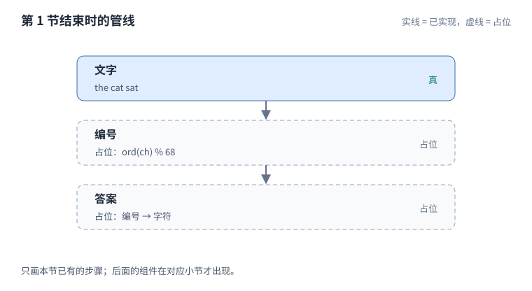
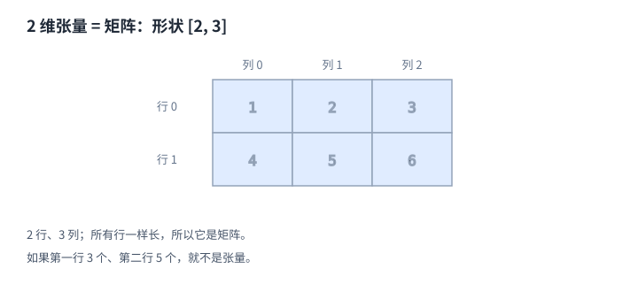

# 1.1 起点与本章交付物

本章要写的程序很小：给它一小段文字，它算出“下一个字符最可能是谁”。这一节先把前半段跑通：文字变成编号，编号变成每个位置的一组数字。要选出下一个字符，得先有模型给出的分数；那要等到 1.7 把完整模型装起来。



*图 1.1-1：第 1 节结束时的管线。只有文字、编号、数字三步；实线是已实现，虚线是占位。*

## 张量（tensor）是多维数组

一个数、一排数、一张表、一摞表，本质上是同一类东西：多维数组。给它一个名字，就是张量（tensor）。

- 0 维：`3.14`
- 1 维：`[1, 2, 3]`
- 2 维：`[[1, 2, 3], [4, 5, 6]]`，就是矩阵
- 3 维：一摞 2 维表



*图 1.1-2：形状 `[2, 3]` 的矩阵。2 行、每行 3 个数，所有行一样长。*

形状（shape）是每一维的长度，而且在**一个张量里是固定的**：`[2, 3]` 表示 2 行、每行 3 个数；不能第一行 3 个、第二行 5 个。所有行必须一样长，这样的二维张量就是矩阵；3 维可以看成一批矩阵。需要另一种形状时可以 `reshape`，但元素总数不变。

本节的一串编号是 `[T]`，每个位置的 16 个数字是 `[B, T, C]`（这里 `B = 1`）。

构造和使用：

```python
import torch

scalar = torch.tensor(3.0)                  # 0 维
vector = torch.tensor([1.0, 2.0, 3.0])      # 1 维
matrix = torch.tensor([[1.0, 2.0, 3.0],
                       [4.0, 5.0, 6.0]])    # 2 维，2 行 3 列
batch = torch.zeros(2, 3, 4)                # 3 维

print(scalar.shape)   # torch.Size([])
print(vector.shape)   # torch.Size([3])
print(matrix.shape)   # torch.Size([2, 3])
print(matrix[0, 1])   # 2.0
print(matrix @ matrix.T)
# tensor([[14., 32.],
#         [32., 77.]])
```

长短不一的行不是张量：

```python
torch.tensor([[1.0, 2.0, 3.0], [4.0, 5.0]])
# ValueError: expected sequence of length 3 at dim 1 (got 2)
```

确实需要长短不一时，可以先补齐到同样长度，或者把每一条单独存成一个张量。

`torch.Tensor` 是 PyTorch 的张量类型：可以索引、做逐元素运算，也可以用 `@` 做矩阵乘法；`.shape` 给出形状。下面的代码用它存 16 个数字。

## 固定示例

后面每节都用同一个输入：`the cat sat`（11 个字符）。每节末尾打印同一组东西：编号、最后一个位置的 16 个数字。分数和答案要到 1.7 才有。

## 需要实现的接口

这一节只有一个模块：`src/llm101/placeholder.py`。1.1 只用到它的占位部分，不会加载后面的代码；后面每节会改它，直到完整模型接手后删掉。

|函数/类型|输入|输出|作用|
|---|---|---|---|
|`_placeholder_ids(text: str)`|一段文字|`list[int]`|把每个字符换成占位编号|
|`_placeholder_vectors(ids: list[int])`|编号列表|`Tensor [1, T, 16]`|每个位置一行 16 个数字|
|`run(text: str, stage: int = 1)`|一段文字|`PipelineResult`|把上面串起来|
|`PipelineResult`|—|`stage` / `text` / `ids` / `vectors`|返回值|

调用顺序：

```python
ids = _placeholder_ids("the cat sat")
vectors = _placeholder_vectors(ids)

result = run("the cat sat")
print(result.vectors.shape)
```

## 参考实现

下面是 1.1 的参考实现；`run` 里的 `stage` 参数和后面的分支在对应小节才加入。

```python
import torch
from dataclasses import dataclass

VOCAB_SIZE = 68
WIDTH = 16


@dataclass(frozen=True)
class PipelineResult:
    stage: int
    text: str
    ids: list[int]
    vectors: torch.Tensor


def _placeholder_ids(text: str) -> list[int]:
    """文字 → 占位编号：字符编码对 68 取余。"""
    return [ord(character) % VOCAB_SIZE for character in text]


def _placeholder_vectors(ids: list[int]) -> torch.Tensor:
    """编号 → [1, T, 16]：每个位置一行 16 个数字。"""
    rows: list[list[float]] = []
    total = 0
    for token_id in ids:
        total += token_id
        rows.append([float((total + index) % WIDTH) for index in range(WIDTH)])
    return torch.tensor([rows], dtype=torch.float32)


def run(text: str, stage: int = 1) -> PipelineResult:
    """跑一遍 1.1 的占位管线。"""
    ids = _placeholder_ids(text)
    vectors = _placeholder_vectors(ids)
    return PipelineResult(stage=stage, text=text, ids=ids, vectors=vectors)
```

## 每个函数的结果

### `_placeholder_ids`

```text
>>> _placeholder_ids("the cat sat")
[48, 36, 33, 32, 31, 29, 48, 32, 47, 29, 48]
```

`t` 的编码是 116，`116 % 68 = 48`；空格是 32。每个字符独立变成一个 0–67 的编号。

### `_placeholder_vectors`

```text
>>> vectors = _placeholder_vectors(ids)
>>> vectors.shape
torch.Size([1, 11, 16])
>>> vectors[0, 0].tolist()
[0.0, 1.0, 2.0, 3.0, 4.0, 5.0, 6.0, 7.0, 8.0, 9.0, 10.0, 11.0, 12.0, 13.0, 14.0, 15.0]
>>> vectors[0, -1].tolist()
[13.0, 14.0, 15.0, 0.0, 1.0, 2.0, 3.0, 4.0, 5.0, 6.0, 7.0, 8.0, 9.0, 10.0, 11.0, 12.0]
```

形状是 `[1, 11, 16]`：1 条输入、11 个位置、每位置 16 个数字。第 `t` 行是“前 `t` 个编号之和 + 0…15”再对 16 取余；所以行是 0…15 的循环平移。

### `run`

```bash
cd ch01/end
uv run python scripts/show_placeholder.py "the cat sat"
```

输出：

```text
stage 1 | text: the cat sat
ids (11)        [48, 36, 33, 32, 31, 29, 48, 32, 47, 29, 48]
vectors[-1]     [13.0, 14.0, 15.0, 0.0, 1.0, 2.0, 3.0, 4.0, 5.0, 6.0, 7.0, 8.0, 9.0, 10.0, 11.0, 12.0]
```

`run` 依次调用前两个函数，把结果装进 `PipelineResult`。本节到数字为止；分数和答案等模型装好后再加。

## 本节之后

本节只有“文字进来”和“编号变数字”是真的；中间是占位。后面每节替换一段：1.2 编号、1.3 数字、1.4 位置、1.5 调匀、1.6 混合、1.7 完整模型（到这时才有 68 个分数和答案）。每节只画当时已有的步骤，后面的组件不会提前出现。

## start 与 end

- `ch01/start/`：动手前的脚手架，函数体是 `TODO 1.x`，另有三个会失败的测试。
- `ch01/end/`：逐节填写后的状态。本节新增 `src/llm101/placeholder.py` 与 `scripts/show_placeholder.py`。

`cd ch01/end && uv run pytest -q` 现在是 **23 passed, 3 failed**：占位模块和零件都通过，失败的是 1.4、1.6、1.7 的三个结构测试。

## 验收

- `cd ch01/end && uv run python scripts/show_placeholder.py "the cat sat"` 有输出
- `cd ch01/end && uv run pytest tests/test_placeholder.py -q` 通过

## 扩展阅读：为什么需要张量

- 模型不能直接算字符，只能算数字；每一步都是对一组数做同样的运算。
- 列表也能存这些数，但没有统一的形状、索引和矩阵乘法。到了注意力和整模型，代码会到处是嵌套循环，形状也容易记错。
- 张量把数字组织成多维数组：`[B, T]` 是编号表，`[B, T, C]` 是每个位置 `C` 个数字。形状本身就是文档，`x @ W` 也能直接写成矩阵乘法。
- 一次放进 `B` 条输入，库的运算会按批处理；代码不用为每条输入写循环。
