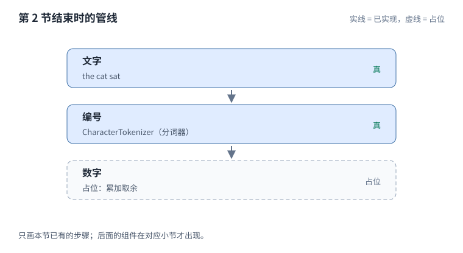

# 1.2 字符级 tokenizer 与接口

模型只会算数字，不会读字符串。这一节把文字和编号互相转换：输入时把每个字符换成词表（所有可选符号的清单）里的一个编号，输出时再把编号换回字符。负责切分的这个角色叫 tokenizer（分词器，也译作标记器、词元切分器）；切出来的每个单位叫 token（词元，也译作标记），它的编号叫 token id（词元编号）。下文有时直接叫它们“符号”和“编号”。这里按单个字符切，所以叫字符级。

## 为什么按字符切

字符级的好处是词表小：26 个小写字母、26 个大写字母、空格、换行、11 个常用标点，再加 3 个特殊符号，一共 68 个。英文句子都能用这套符号拼出来，碰到词表外的字符也有兜底。代价是一串编号会变长：`the cat sat` 有 11 个字符，就会得到 11 个编号；如果按整词切，只要 3 个。

第 2 章会换一种更高效的切分方式，把常见的字符组合并成一个单位；词表会变大，但对外的五个成员不变。

## 三个特殊符号

这三个名字都是英文缩写：

- `<bos>` 是 beginning of sequence 的缩写，标出一串编号的开头；模型从这里开始读。
- `<eos>` 是 end of sequence 的缩写，标出结尾；模型读到它就知道该停了。
- `<unk>` 是 unknown 的缩写，接住词表外的字符。比如汉字不在本章的词表里，会被换成 `<unk>`；换回来时默认跳过它，所以这部分信息会丢。这里选兜底而不是报错：演示页面里输错一个字符，不该让整段输入直接失败。

`<pad>` 是 padding 的缩写，代表另一种占位符：一次处理多条长短不一的输入时，用它把短的补齐。本章一次只处理一条，用不到 `<pad>`，词表里也不放。

## 接口

这一节要实现 `CharacterTokenizer` 的五个成员：

|成员|输入|输出|作用|
|---|---|---|---|
|`CharacterTokenizer(vocabulary, unknown_token="<unk>")`|符号表|tokenizer|建立词表与编号映射|
|`encode(text, add_bos=False, add_eos=False)`|文字|`list[int]`|切分并编号|
|`decode(ids, skip_special_tokens=True)`|编号|文字|编号还原|
|`vocab_size`|—|`int`|词表大小（68）|
|`bos_id` / `eos_id`|—|`int`|开头/结尾编号|

调用方式：

```python
tokenizer = CharacterTokenizer(DEFAULT_VOCABULARY)
ids = tokenizer.encode("the cat sat", add_bos=True, add_eos=True)
text = tokenizer.decode(ids)
print(tokenizer.vocab_size, tokenizer.bos_id, tokenizer.eos_id)
```


## 参考实现

`DEFAULT_VOCABULARY` 给出上面这 68 个符号的默认顺序；`CharacterTokenizer` 也可以接受别的词表。核心是 `encode` 和 `decode`：

```python
def encode(
    self,
    text: str,
    *,
    add_bos: bool = False,
    add_eos: bool = False,
) -> list[int]:
    unknown_id = self._token_to_id[self._unknown_token]
    ids = [self._token_to_id.get(character, unknown_id) for character in text]
    if add_bos:
        ids.insert(0, self.bos_id)
    if add_eos:
        ids.append(self.eos_id)
    return ids
```


```python
from collections.abc import Sequence


def decode(
    self,
    ids: Sequence[int],
    *,
    skip_special_tokens: bool = True,
) -> str:
    pieces: list[str] = []
    for token_id in ids:
        if token_id < 0 or token_id >= len(self._vocabulary):
            raise ValueError(f"token id out of range: {token_id}")
        token = self._vocabulary[token_id]
        if skip_special_tokens and token in self._special_tokens:
            continue
        pieces.append(token)
    return "".join(pieces)
```

- 查表用 `.get(character, unknown_id)`：词表里有的字符给编号，没有的给 `<unk>` 的编号。
- `add_bos` / `add_eos` 决定是否在两端加边界符号，默认不加。
- `decode` 按编号查回字符；`skip_special_tokens=True` 时跳过三个特殊符号，于是 `decode(encode(text))` 得到原文。
- 这个往返只对词表覆盖的字符成立；含未知字符的文本换回来时会少掉那些字符。

## 每个函数的结果

```text
>>> tokenizer = CharacterTokenizer(DEFAULT_VOCABULARY)
>>> tokenizer.vocab_size
68
>>> tokenizer.bos_id, tokenizer.eos_id
(66, 67)
>>> ids = tokenizer.encode("the cat sat", add_bos=True, add_eos=True)
>>> ids
[66, 19, 7, 4, 52, 2, 0, 19, 52, 18, 0, 19, 67]
>>> tokenizer.decode(ids)
'the cat sat'
>>> tokenizer.decode(ids, skip_special_tokens=False)
'<bos>the cat sat<eos>'
```

- `vocab_size` 是 68；`bos_id` 和 `eos_id` 分别是 66、67，对应词表最后三个特殊符号。
- `encode` 在每个字符的编号之外，两端加了 `<bos>`/`<eos>`，所以 11 个字符得到 13 个编号。
- `decode` 默认跳过特殊符号，于是回到原文；不跳过时能看到边界符号。

## 本节结束后的管线



*图 1.2-1：第 2 节结束时的管线。编号变成实线；数字仍是占位。*

```bash
cd ch01/end
uv run python scripts/show_placeholder.py --stage 2 "the cat sat"
```

输出：

```text
stage 2 | text: the cat sat
ids (13)        [66, 19, 7, 4, 52, 2, 0, 19, 52, 18, 0, 19, 67]
vectors[-1]     [5.0, 6.0, 7.0, 8.0, 9.0, 10.0, 11.0, 12.0, 13.0, 14.0, 15.0, 0.0, 1.0, 2.0, 3.0, 4.0]
```

编号从 11 个变成 13 个（`<bos>` + 11 + `<eos>`）；数字还是占位，但编号变了，数字也跟着变。

## 与第 2 章的约定

第 2 章换切分方式时，下面五个成员的名字和行为保持不变：`encode`、`decode`、`vocab_size`、`bos_id`、`eos_id`。模型、测试和页面只依赖这五个，不关心内部是逐字符还是按片段切。

代码在 `ch01/end/src/llm101/tokenizer.py`，测试在 `ch01/end/tests/test_tokenizer.py`；运行 `cd ch01/end && uv run pytest tests/test_tokenizer.py -q`。
