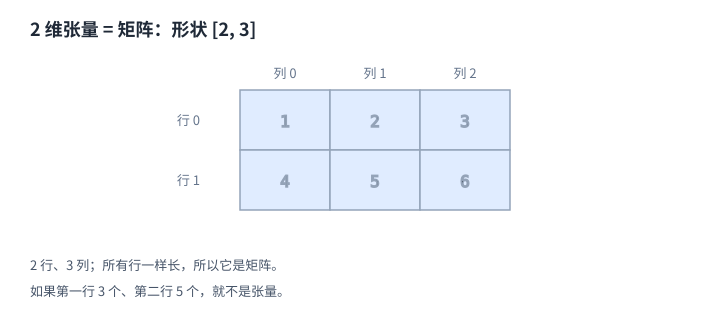
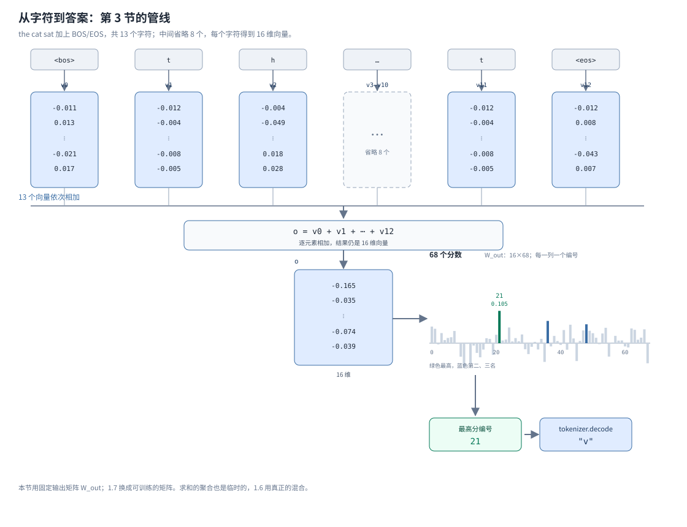
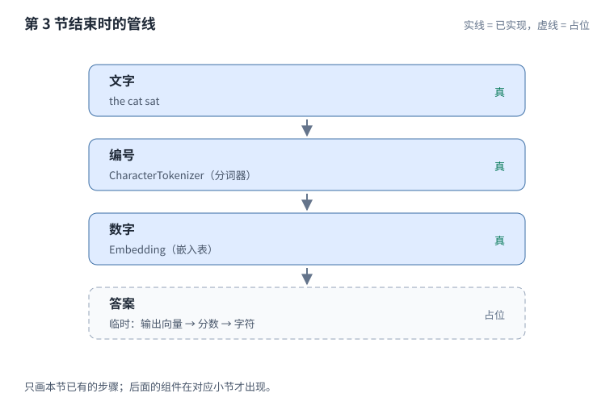

# 1.3 嵌入表与张量形状

1.2 把文字变成了编号，但模型要算的是一串串数字。这一节先把“一串数字”这件事讲清楚：它就是张量；然后用 `Embedding` 把每个编号变成一行数字。

## 张量（tensor）是多维数组

一个数、一排数、一张表、一摞表，本质上是同一类东西：多维数组。给它一个名字，就是张量（tensor）。

- 0 维：`3.14`
- 1 维：`[1, 2, 3]`
- 2 维：`[[1, 2, 3], [4, 5, 6]]`，就是矩阵
- 3 维：一摞 2 维表



*图 1.3-1：形状 `[2, 3]` 的矩阵。2 行、每行 3 个数，所有行一样长。*

形状（shape）是每一维的长度，而且在**一个张量里是固定的**：`[2, 3]` 表示 2 行、每行 3 个数；不能第一行 3 个、第二行 5 个。所有行必须一样长，这样的二维张量就是矩阵；3 维可以看成一批矩阵。需要另一种形状时可以 `reshape`，但元素总数不变。

构造和使用：

```python
import torch

scalar = torch.tensor(3.0)                  # 0 维
vector = torch.tensor([1.0, 2.0, 3.0])      # 1 维
matrix = torch.tensor([[1.0, 2.0, 3.0],
                       [4.0, 5.0, 6.0]])    # 2 维，2 行 3 列

print(scalar.shape)   # torch.Size([])
print(vector.shape)   # torch.Size([3])
print(matrix.shape)   # torch.Size([2, 3])
print(matrix[0, 1])   # 2.0
```

长短不一的行不是张量：

```python
torch.tensor([[1.0, 2.0, 3.0], [4.0, 5.0]])
# ValueError: expected sequence of length 3 at dim 1 (got 2)
```

确实需要长短不一时，可以先补齐到同样长度，或者把每一条单独存成一个张量。

`torch.Tensor` 是 PyTorch 的张量类型：可以索引、做逐元素运算；`.shape` 给出形状。下面的 `Embedding` 用它存每个位置的数字。

## 形状：`[T]` 和 `[T, C]`

- 一串编号是 `[T]`，$T$ 是字符数。
- 每个位置的数字是 `[T, C]`，$C$ 是每个位置用几个数字表示；本章 $C = 16$，代码里这个宽度叫 `d_model`。

`Embedding` 吃 `[T]`、吐 `[T, C]`。

## Embedding：嵌入表

### 问题：编号不能直接算

模型只会做数字运算，而编号是离散的索引：1、2、3 只是位置。$1 + 2 = 3$ 只是编号碰巧，$(1 + 2) / 2 = 1.5$ 更不是一个编号——编号本身不能做有意义的算术。

### 思路：给每个编号一串数字

一种朴素办法是 one-hot（独热）：68 个编号就用 68 个数，其中只有第 $i$ 个是 1，其余是 0。它有两个问题：维度大、几乎全是 0；任意两个符号的距离都一样，模型学不出“哪些符号更接近”。

`Embedding` 用一张 68 行、每行 $C$ 个数字的表：第 $i$ 个编号取第 $i$ 行。它把离散符号变成稠密、可调整的向量；同一个编号永远取同一行，所以同一个符号在不同位置用的是同一个表示。

比如编号 1 和 2：它们的平均 1.5 不是一个编号；但两行 `[1, 2, 3]` 和 `[4, 5, 6]` 的平均 `[2.5, 3.5, 4.5]` 仍然是一串可以继续计算的数字。后面的层要做的正是这种加权组合。

### 定义：查表

`Embedding`（嵌入表）就是这张表：输入 `[T]`，输出 `[T, C]`；表有 `vocab` 行、每行 $C$ 个数字，没有偏置。初始化乘 0.02。它的作用一句话：**把编号变成后续层能计算的向量**；模型内部不再直接使用编号。

### 名字：为什么叫 embedding

`embed` 在英语里是“嵌入、把……放进”的意思。编号是离散的符号，本身不在连续空间里；嵌入表把每个编号放进一个 16 维的连续空间，给它一个坐标。被放进去的那行向量叫 embedding vector（嵌入向量），这张表叫 embedding table；中文“嵌入表”是译名，英文强调的是“把离散符号放进连续空间”这个动作和结果。

所以 `Embedding` 不只是“查表”：查表是手段，让 token 在连续空间里有一个位置才是目的；后面的层才能对这些向量做加减和加权。

用法：`Embedding(num_embeddings, embedding_dim)` 构造，`forward(ids)` 查表。输入 `[T]`，输出 `[T, C]`。


`Embedding(68, 16)` 得到一张 68 行、每行 16 个数字的表；`forward([1, 3])` 返回 2 行、每行 16 个数字。

```python
def __init__(
    self,
    num_embeddings: int,
    embedding_dim: int,
    *,
    generator: torch.Generator | None = None,
    dtype: torch.dtype = torch.float32,
) -> None:
    # 建立查表
    ...

def forward(self, token_ids: torch.Tensor) -> torch.Tensor:
    # 按编号取行
    ...
```

### 名字：为什么叫 forward

`forward` 是“向前”。神经网络里的 forward pass（前向计算）是从输入算到输出；反方向从输出或损失算回参数叫 backward pass（反向传播），第 3 章再讲。

PyTorch 的 `nn.Module` 把模块的计算方法命名为 `forward`：调用 `module(...)` 时，`__call__` 会转到 `forward`。本书的 `Embedding.forward` 和 `TinyGPT.forward` 沿用这个名字——它表示“这是从输入到输出的那一步”，具体算什么由方法体决定。所以 `forward` 不是某个模型特有的算法名，而是计算方向的约定。

计算步骤：

1. 取一个编号 `i`。
2. 取表的第 `i` 行，得到 `C` 个数。
3. 对 `T` 个位置重复。

参考实现：

```python
class Embedding:
    def __init__(
        self,
        num_embeddings: int,
        embedding_dim: int,
        *,
        generator: torch.Generator | None = None,
        dtype: torch.dtype = torch.float32,
    ) -> None:
        if num_embeddings <= 0 or embedding_dim <= 0:
            raise ValueError("embedding dimensions must be positive")
        initial = (
            torch.randn(
                num_embeddings, embedding_dim, generator=generator, dtype=dtype
            )
            * 0.02
        )
        self.weight = initial
        self.num_embeddings = num_embeddings
        self.embedding_dim = embedding_dim

    def forward(self, token_ids: torch.Tensor) -> torch.Tensor:
        if token_ids.dtype != torch.long:
            raise TypeError("embedding indices must have dtype torch.long")
        if token_ids.numel() and (
            bool((token_ids < 0).any())
            or bool((token_ids >= self.num_embeddings).any())
        ):
            raise IndexError("embedding index is outside the vocabulary")
        return self.weight[token_ids]
```

## 一组输入和输出

![数据流：编号 [T] 经嵌入表变成 [T, C]](../../assets/ch01/02-layers.svg)

*图 1.3-2：编号经嵌入表变成每个位置的一行数字。*

先用一个小到能手算的例子。设查表的四行是：

|编号|`E` 的这一行|
|---|---|
|0|0, 0, 0|
|1|1, 2, 3|
|2|4, 5, 6|
|3|7, 8, 9|

用 `ids = [1, 3]` 查表：

|步骤|输入|输出|形状|
|---|---|---|---|
|查表|`[1, 3]`|`[[1, 2, 3], [7, 8, 9]]`|`[2, 3]`|

查表用公式写就是 $h[t] = E[\mathrm{ids}[t]]$：$\mathrm{ids}[0] = 1$ 取第 1 行 `[1, 2, 3]`；$\mathrm{ids}[1] = 3$ 取第 3 行 `[7, 8, 9]`。

把整句 `the cat sat` 送进管线，就得到下面这张结构图：



*图 1.3-3：13 个字符各自向下经过嵌入表变成 16 维向量（图中省略中间 8 个字符，每个向量只列首尾几个分量）；向量依次相加得到输出向量 $o$；$o$ 与输出矩阵 $W_{\text{out}}$ 得到 68 个分数；编号 21 的分数最高，解码成字符 `v`。*

13 个字符（`<bos>`、11 个可见字符、`<eos>`）各查表得到一行 16 个数字；把 13 行按位置相加，得到一个 16 个数字的输出向量 $o$。再用输出矩阵 $W_{\text{out}}$ 把 $o$ 变成 68 个分数；分数最高的编号是 21；用 1.2 的 tokenizer 解码得到 `v`。

$$
\begin{aligned}
o &= v_0 + v_1 + \cdots + v_{12} \\
\text{scores} &= o \times W_{\text{out}}
\end{aligned}
$$

### 输出向量怎么变成编号

一种偷懒做法是对 $o$ 的 16 个分量求和、乘 1000、取整、对 68 取余。这个数跟词表没有关系：换个词表大小或换一种编号顺序，结果就变了，而且它不能说明“为什么是这个词”。

更接近实际的做法是给每个词表编号一个 16 维的输出方向。把 68 个方向叠成输出矩阵 $W_{\text{out}}$（形状 `[16, 68]`），$o$ 和每一列逐项相乘再相加，得到 68 个分数；分数最高的那一列的编号就是答案。这正是模型最后一层的结构：把 16 维向量变成词表上的分数。1.7 会把这张矩阵变成可训练的；本节先用一个固定的 $W_{\text{out}}$（`manual_seed(24)`）代替训练好的矩阵，分数和编号会变，但结构已经是实际的结构。

|量|结果|
|---|---|
|输出向量 $o$|见上图：16 个数字|
|最高分|0.105，编号 21|
|第二、三名|0.073（36）、0.062（48）|
|字符|`v`|

这里把 13 个向量相加，只是本节的临时聚合；真正的模型在 1.6 用真正的混合，并取最后一个位置的向量。1.4 先补位置，1.5 补调匀和筛选，1.6 补混合。

### 从答案编号变回字符

编号 21 在词表里是 `v`：1.2 的 tokenizer 用 `decode([21])` 把它变回字符。1.3 的占位函数 `_placeholder_character` 对 0–25 的编号也查同一张小写字母表，所以这个例子里两条路都得到 `v`；1.7 的正式输出统一用 tokenizer 的 decode。

## 本节结束后的管线



*图 1.3-4：第 3 节结束时的管线。编号、数字是实线，答案的分数来自固定的输出矩阵，还不是训练好的。*

```bash
cd ch01/end
uv run python scripts/show_placeholder.py --stage 3 "the cat sat"
```

输出：

```text
stage 3 | text: the cat sat
ids (13)        [66, 19, 7, 4, 52, 2, 0, 19, 52, 18, 0, 19, 67]
vectors         (13, 16)
output          [-0.165, -0.035, -0.115, 0.038, 0.021, 0.023, -0.073, -0.18, -0.084, -0.003, -0.091, -0.115, 0.05, 0.101, -0.074, -0.039]
scores          68 | max 0.105 at 21
answer          21
character       'v'
```

编号 13 个；`vectors` 是 13 行 × 16 个数字；`output` 是 13 行逐位置相加的结果；`scores` 是 68 个分数，最高 0.105 在编号 21；`character` 是 `v`。位置在 1.4、混合和调匀在 1.5–1.6 才出现；1.7 才换成可训练的矩阵和取最高分。

## 现在能运行什么

1.3 只是把零件做好，整个模型还没组装。零件和管线都能跑（上面的 stage 3）；零件单独用时可以这样验证：

```python
import torch
from llm101.layers import Embedding

ids = torch.tensor([1, 3])
embedding = Embedding(4, 3, generator=torch.Generator().manual_seed(0))
hidden = embedding.forward(ids)

print("ids", tuple(ids.shape))
print("hidden", tuple(hidden.shape))
```

输出：

```text
ids (2,)
hidden (2, 3)
```


```python
from llm101.placeholder import run

result = run("the cat sat", stage=3)
print(result.character)
```

输出：

```text
v
```

`cd ch01/end && uv run pytest tests/test_layers.py -q` 有 4 项通过。整个模型还不能跑：`TinyGPT` 目前只有嵌入部分（1.4），完整模型在 1.7；`pytest -q` 里 1.6、1.7 的两个测试仍然失败，页面也要到 1.9/1.10 才有。管线在本节已经能跑（stage 3）；位置在 1.4、混合和调匀在 1.5–1.6 才加。代码在 `ch01/end/src/llm101/layers.py`（嵌入表）和 `placeholder.py`（临时管线），测试在 `tests/test_layers.py` 和 `tests/test_placeholder.py`。
