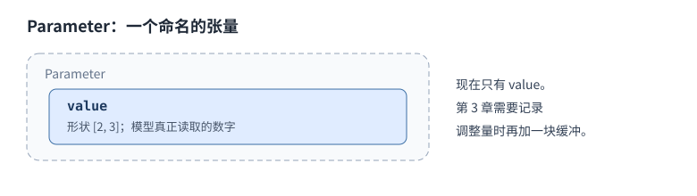

# 1.3 参数与张量形状约定

1.2 把文字变成了编号，但模型要算的是一串串数字，也就是 1.1 介绍的张量。这一节定下两件基础事情：数字存在哪里——参数（parameter），以及它们在计算中长什么样——形状（shape）。

## 本节需要实现的函数

### `Parameter`

`Parameter` 把一个张量值和一个同形状的 `grad` 缓冲绑在一起；`zero_grad()` 把缓冲清零。

输入：`torch.Tensor`；输出：参数对象。

```text
>>> parameter = Parameter(torch.ones(2, 3))
>>> parameter.value.shape, parameter.grad.shape
(torch.Size([2, 3]), torch.Size([2, 3]))
```

```python
def __init__(self, value: torch.Tensor) -> None:
    # 存 value 和同形状 grad
    ...

def zero_grad(self) -> None:
    # 清零 grad
    ...
```

### `Linear`

`Linear` 做 `y = x @ W + b`；`parameters()` 交出权重和偏置。

输入：`[..., in]`；输出：`[..., out]`。

```text
>>> linear = Linear(4, 3)
>>> linear.forward(torch.zeros(2, 5, 4)).shape
torch.Size([2, 5, 3])
>>> len(linear.parameters())
2
```

```python
def __init__(
    self,
    in_features: int,
    out_features: int,
    *,
    generator: torch.Generator | None = None,
    dtype: torch.dtype = torch.float32,
) -> None:
    # 建立权重和偏置
    ...

def forward(self, inputs: torch.Tensor) -> torch.Tensor:
    # y = x @ W + b
    ...

def parameters(self) -> tuple[Parameter, Parameter]:
    # 交出权重和偏置
    ...
```

### `Embedding`

`Embedding` 按编号查表；`parameters()` 交出表。

输入：`[B, T]`；输出：`[B, T, C]`。

```text
>>> embedding = Embedding(68, 16)
>>> embedding.forward(torch.tensor([[1, 3]])).shape
torch.Size([1, 2, 16])
>>> len(embedding.parameters())
1
```

```python
def __init__(
    self,
    num_embeddings: int,
    embedding_dim: int,
    *,
    generator: torch.Generator | None = None,
    dtype: torch.dtype = torch.float32,
) -> None:
    # 建立查表
    ...

def forward(self, token_ids: torch.Tensor) -> torch.Tensor:
    # 按编号取行
    ...

def parameters(self) -> tuple[Parameter]:
    # 交出查表
    ...
```

## 参数不是裸张量

模型的每个可调整的数字都装在 `Parameter` 里：`value` 放数字，`grad` 放一块同形状的缓冲。



*图 1.3-1：Parameter 的结构。本章只读 value，grad 一直是零。*

多出来的那块是给第 3 章准备的——到时要记录“每个数字该往哪调”，现在先把位置留出来。

```python
class Parameter:
    def __init__(self, value: torch.Tensor) -> None:
        if value.requires_grad:
            raise ValueError("LLM 101 does not use autograd")
        self.value = value.clone()
        self.grad = torch.zeros_like(self.value)

    def zero_grad(self) -> None:
        self.grad.zero_()
```

`value` 会复制一份，之后外部再改原来的张量也不会影响参数。检查 `requires_grad` 是在声明：本课程不用 autograd（自动求导），数字怎么变由我们自己写。

## 两个形状

|数据|形状|含义|
|---|---|---|
|编号|`[B, T]`|`B` 是同时处理的条数，`T` 是一条里的编号个数|
|隐藏状态（hidden state）|`[B, T, C]`|每个位置用 `C` 个数字表示；本章 `C = 16`|

`B` 是批（batch）的大小：批只是把多条输入摞在一起，不会混合。同一条输入放在批的第一位还是第二位，算出来的结果一样，只是多了一维。

`C` 是每个位置的宽度；代码里这个宽度叫 `d_model`，1.7 会把它放进配置。

## 线性层

`Linear`（线性层）做一次矩阵乘法再加偏置：

```text
y = x @ W + b
```

输入 `[B, T, in]`，输出 `[B, T, out]`；权重（weight）`W` 是 `[in, out]`，偏置（bias）`b` 是 `[out]`。参数个数是 `in × out + out`。初始化时，`W` 用 `sqrt(2/(in+out))` 缩放的正态分布，`b` 从零开始。（`torch.Generator` 只用来固定随机种子；种子相同，初始化就相同。）

参考实现：

```python
class Linear:
    def __init__(
        self,
        in_features: int,
        out_features: int,
        *,
        generator: torch.Generator | None = None,
        dtype: torch.dtype = torch.float32,
    ) -> None:
        scale = math.sqrt(2.0 / (in_features + out_features))
        weight = torch.randn(
            in_features, out_features, generator=generator, dtype=dtype
        ) * scale
        self.weight = Parameter(weight)
        self.bias = Parameter(torch.zeros(out_features, dtype=dtype))
        self.in_features = in_features
        self.out_features = out_features

    def forward(self, inputs: torch.Tensor) -> torch.Tensor:
        return inputs @ self.weight.value + self.bias.value

    def parameters(self) -> tuple[Parameter, Parameter]:
        return self.weight, self.bias
```

## 嵌入表

`Embedding`（嵌入表）是一张查表：第 `i` 个编号取第 `i` 行。输入 `[B, T]`，输出 `[B, T, C]`；参数个数是 `vocab × C`，没有偏置。初始化乘 0.02。

参考实现：

```python
class Embedding:
    def __init__(
        self,
        num_embeddings: int,
        embedding_dim: int,
        *,
        generator: torch.Generator | None = None,
        dtype: torch.dtype = torch.float32,
    ) -> None:
        initial = torch.randn(
            num_embeddings, embedding_dim, generator=generator, dtype=dtype
        ) * 0.02
        self.weight = Parameter(initial)
        self.num_embeddings = num_embeddings
        self.embedding_dim = embedding_dim

    def forward(self, token_ids: torch.Tensor) -> torch.Tensor:
        return self.weight.value[token_ids]

    def parameters(self) -> tuple[Parameter]:
        return (self.weight,)
```

真正的 `forward` 还会检查编号的类型和范围，不对就报错。

## 一组输入和输出

![数据流：编号 [B,T] 经嵌入表变成 [B,T,C]，再经线性层变成 [B,T,out]](../../assets/ch01/02-layers.svg)

*图 1.3-2：从编号到输出的两步形状变化。*

用一个小到能手算的例子。设查表的四行、权重和偏置是：

```python
E = [[0, 0, 0], [1, 2, 3], [4, 5, 6], [7, 8, 9]]
W = [[1, 0], [0, 1], [1, 1]]
b = [0.5, -0.5]
ids = [[1, 3]]
```

|步骤|输入|输出|形状|
|---|---|---|---|
|查表|`[[1, 3]]`|`[[[1, 2, 3], [7, 8, 9]]]`|`[1, 2, 3]`|
|线性|`[[[1, 2, 3], [7, 8, 9]]]`|`[[[4.5, 4.5], [16.5, 16.5]]]`|`[1, 2, 2]`|

第一个位置是这么算出来的：

```text
out[0, 0, 0] = 1×1 + 2×0 + 3×1 + 0.5 = 4.5
out[0, 0, 1] = 1×0 + 2×1 + 3×1 − 0.5 = 4.5
```

第二个位置用 `[7, 8, 9]`，得到 `[16.5, 16.5]`。

## 每个函数的结果

```text
>>> parameter = Parameter(torch.ones(2, 3))
>>> parameter.value.shape, parameter.grad.shape
(torch.Size([2, 3]), torch.Size([2, 3]))
>>> int(parameter.grad.sum())
0
>>> linear = Linear(4, 3)
>>> linear.forward(torch.zeros(2, 5, 4)).shape
torch.Size([2, 5, 3])
>>> len(linear.parameters())
2
>>> embedding = Embedding(68, 16)
>>> embedding.forward(torch.tensor([[1, 3]])).shape
torch.Size([1, 2, 16])
>>> len(embedding.parameters())
1
```

- `Parameter`：`value` 和 `grad` 形状相同；本章 `grad` 全是 0。
- `Linear`：输入 `[2, 5, 4]`、输出 `[2, 5, 3]`；参数是权重和偏置两份。
- `Embedding`：输入 `[1, 2]`、输出 `[1, 2, 16]`；只有一张表一份参数（68 × 16）。

## 本节结束后的管线


*图 1.3-4：第 3 节结束时的管线。编号、数字都是实线；位置、混合、调匀还没出现。*

```bash
cd ch01/end
uv run python scripts/show_placeholder.py --stage 3 "the cat sat"
```

输出：

```text
stage 3 | text: the cat sat
ids (13)        [66, 19, 7, 4, 52, 2, 0, 19, 52, 18, 0, 19, 67]
vectors[-1]     [-0.012, 0.008, -0.025, -0.001, -0.001, 0.012, -0.009, -0.024, -0.031, 0.009, -0.055, 0.001, -0.004, -0.016, -0.043, 0.007]
```

编号 13 个；`vectors[-1]` 已经是查表得到的 16 个数字，不再用累加取余；管线到数字为止。`Linear` 是本节新增的零件，1.6/1.7 会用它构造注意力和输出。位置、混合、调匀要到 1.4–1.6 才出现。

## 现在能运行什么

1.3 只是把零件做好，整个模型还没组装。零件和管线都能跑（上面的 stage 3）；零件单独用时可以这样验证：

```python
import torch
from llm101.layers import Embedding, Linear

ids = torch.tensor([[1, 3]])
embedding = Embedding(4, 3, generator=torch.Generator().manual_seed(0))
hidden = embedding.forward(ids)
linear = Linear(3, 2, generator=torch.Generator().manual_seed(1))
out = linear.forward(hidden)

print("ids", tuple(ids.shape))
print("hidden", tuple(hidden.shape))
print("out", tuple(out.shape))
```

输出：

```text
ids (1, 2)
hidden (1, 2, 3)
out (1, 2, 2)
```

`cd ch01/end && uv run pytest tests/test_layers.py -q` 有 11 项通过。整个模型还不能跑：`TinyGPT` 仍是空壳，`pytest -q` 里 1.4、1.6、1.7 的三个测试仍然失败，页面也要到 1.9/1.10 才有。管线在本节已经能跑（stage 3）；位置、混合、调匀还没出现，1.4–1.6 才加。代码在 `ch01/end/src/llm101/parameters.py` 与 `layers.py`，测试在 `ch01/end/tests/test_layers.py`。

## 数学补充

![矩阵乘法：x [2,3] 乘 W [3,2] 再加偏置得到 y [2,2]](../../assets/ch01/03-matmul.svg)

*图 1.3-3：一次矩阵乘法。绿色是第一个输出位置，橙色是 `W` 的第二列。*

- **矩阵乘法**：`x` 的最后一维必须等于 `W` 的第一维，结果的形状是 `x` 的前几维接上 `W` 的最后一维。每个输出元素是一次点积：`y[..., o] = Σi x[..., i] × W[i, o]`。
- **广播**：`b` 只有 `out` 个数，却要加到 `B × T` 个位置上；PyTorch 会把它沿着前面的维度重复，这叫广播（broadcast）。
- **参数个数**：`Linear` 是 `in × out + out`（矩阵加偏置）；`Embedding` 只有表，是 `vocab × C`。
- **初始化尺度**：一个输出是 `in` 个乘积的和，`in` 越大，和的量级越容易变大；把权重乘上 `sqrt(2/(in+out))`，可以让初始输出保持在同一量级。严格的方差推导可以以后再做，先记住这个尺度。

## 扩展阅读：为什么要参数对象和嵌入表

- 参数对象：模型里每个可调整的数字，第 3 章还要记录“它该往哪调”。裸张量只有值，没有地方挂这份信息；`Parameter` 把值和一块同形状的空间绑在一起。
- 嵌入表：编号是离散的，查表把每个编号映射成一串数字。相同编号自然取到同一行，调整时也会落到同一行（第 3 章）；这是“离散符号 → 连续数字”的最简单做法。
