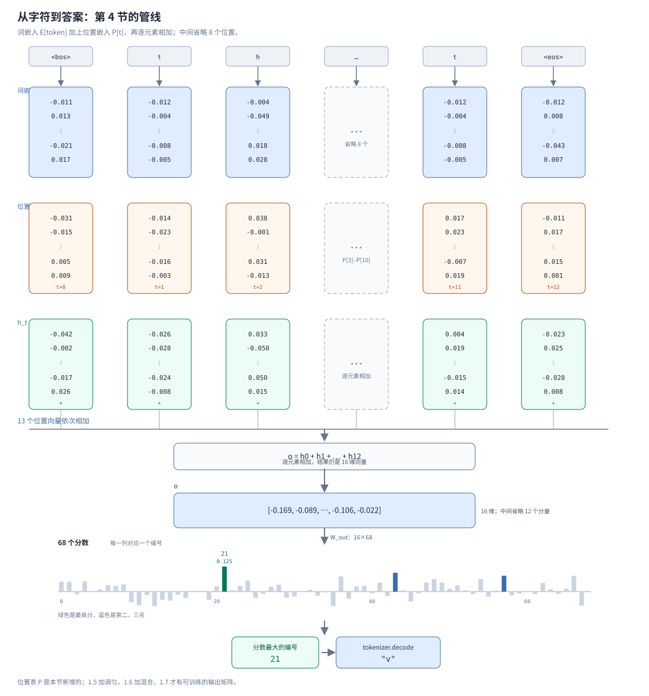
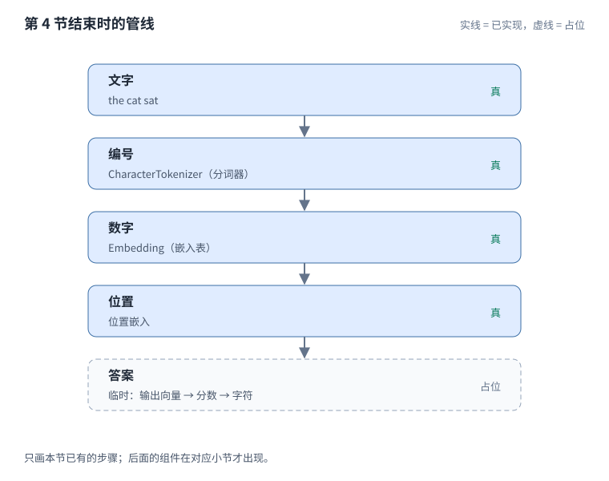

# 1.4 位置嵌入与批次

1.3 的 `Embedding` 把每个编号变成一行 16 个数字，但同一行只由编号决定：`t` 在句首和句尾拿到的是同一行向量。模型要预测下一个字，必须知道“这个字在什么位置”。这一节给每个位置再加一行数字，把位置信息加到词向量上。

## 为什么需要位置嵌入

### 问题：同一张表不知道位置

`Embedding` 是一张按编号取行的表。输入编号 19，无论在第一个位置还是最后一个位置，取出的都是同一行 16 个数字。单独看这些向量，`the cat sat` 和 `sat cat the` 只是同一批向量换了顺序；如果后面的步骤只把所有位置放在一起看，而不区分“谁在前、谁在后”，这两个句子就没有区别。

预测下一个字恰恰依赖顺序。“the cat” 后面更可能是 `space`，而 “cat the” 后面更可能是别的字；模型需要知道当前 token 在序列里的位置。

### 思路：给每个位置再学一行

给位置也建一张表：第 0 行给第一个位置，第 1 行给第二个位置，依此类推。每个位置有自己的一行 16 个数字，和词向量逐元素相加：

$$
h_t = E[\mathrm{id}_t] + P[t], \qquad t = 0, 1, \ldots, T-1
$$

同一个 token 出现在位置 0 和位置 1，词向量 `E` 相同，位置向量 `P[0]`、`P[1]` 不同，相加后的 `h_0`、`h_1` 就不同。模型因此能区分“同一个字在什么位置”。

### 定义：位置嵌入

位置嵌入（position embedding）是一张 `max_seq_len` 行、`d_model` 列的表：第 `t` 行是位置 `t` 的向量。`max_seq_len = 16`，所以表有 16 行、每行 16 个数字，共 256 个数字。

位置编号（position id）是 `0, 1, …, T-1`，和 token id 不是一回事：token id 是词表里的编号，position id 是序列里的位置。位置表用 `Embedding(16, 16)` 创建，查询时传入 `torch.arange(T)`。

`max_seq_len` 同时是上下文长度（context length）：模型一次最多处理 16 个位置。`the cat sat` 加上 `<bos>`/`<eos>` 是 13 个位置，用到 `P[0]` 到 `P[12]`；13、14、15 三行暂时用不到。超过 16 个位置必须报错，不能悄悄截断。

## 位置表与加法

位置表 `P` 的前两行（只列首尾各两个数字）是：

|位置|前 2 个数字|后 2 个数字|
|---|---|---|
|0|-0.031, -0.015|0.005, 0.009|
|1|-0.014, -0.023|-0.016, -0.003|

token id 19 的词向量 `E[19]` 是 `[-0.012, -0.004, …, -0.008, -0.005]`。把同一个 token 放到位置 0 和位置 1：

|量|前 2 个数字|后 2 个数字|
|---|---|---|
|`E[19]`|-0.012, -0.004|-0.008, -0.005|
|`P[0]`|-0.031, -0.015|0.005, 0.009|
|$h_0 = E[19] + P[0]$|-0.043, -0.019|-0.004, 0.004|
|`P[1]`|-0.014, -0.023|-0.016, -0.003|
|$h_1 = E[19] + P[1]$|-0.026, -0.028|-0.024, -0.008|

`h_0` 和 `h_1` 不同，尽管它们来自同一个 token。位置向量和词向量逐元素相加，形状仍是 `[T, C]`：13 个位置就是 13 行、每行 16 个数字。

## 本节需要实现的函数

本节填 `TinyGPT` 的嵌入部分。`TinyGPT` 是第 1 章最终要组装的模型；1.4 只实现它的构造和“词嵌入 + 位置嵌入”这一步，后面的步骤和输出留到 1.7。

### `TinyGPT.__init__`

用 `TinyGPT(config, generator=...)` 构造模型；`config` 里的 `max_seq_len` 决定位置表有几行。构造后有两个表：

- `token_embedding`：68 行 × 16 个数字，按 token id 取行；
- `position_embedding`：16 行 × 16 个数字，按 position id 取行。

输入是 `GPTConfig` 和可选的随机数生成器；输出是一个模型对象。

```text
>>> model = TinyGPT(small_config(), generator=...)
>>> model.token_embedding.weight.shape
torch.Size([68, 16])
>>> model.position_embedding.weight.shape
torch.Size([16, 16])
```

```python
def __init__(
    self,
    config: GPTConfig,
    *,
    generator: torch.Generator | None = None,
    dtype: torch.dtype = torch.float32,
) -> None:
    # 建立 token 表和 position 表
    ...
```

### `TinyGPT.forward`

把一条编号序列送进模型：先查 token 表，再按位置查 position 表，两者逐元素相加。`forward` 是 1.3 解释过的“前向计算”——从输入算到输出；1.4 的 `forward` 只返回每个位置的向量 `[T, C]`，1.7 才接上后面的步骤和输出。

输入是 `[T]` 的 `torch.long` 编号；输出是 `[T, C]`。如果 `T > max_seq_len`，在函数最前面抛 `ValueError`，错误信息里保留 `context`。

```text
>>> model.forward(torch.tensor([19])).shape
torch.Size([1, 16])
>>> model.forward(torch.tensor([0, 19])).shape
torch.Size([2, 16])
>>> model.forward(torch.zeros(1, 17, dtype=torch.long))
ValueError: ... context ...
```

```python
def forward(self, token_ids: torch.Tensor) -> torch.Tensor:
    # 检查上下文长度；查两张表；逐元素相加
    ...
```

1.4 的示例按一条序列 `[T]` 写；`TinyGPT` 的索引也能处理 2D 输入。批次和批次维见下面的「批次与批次维」。

## 参考实现

`TinyGPT` 的构造和嵌入前向：

```python
class TinyGPT:
    def __init__(
        self,
        config: GPTConfig,
        *,
        generator: torch.Generator | None = None,
        dtype: torch.dtype = torch.float32,
    ) -> None:
        self.config = config
        self.token_embedding = Embedding(
            config.vocab_size, config.d_model, generator=generator, dtype=dtype
        )
        self.position_embedding = Embedding(
            config.max_seq_len, config.d_model, generator=generator, dtype=dtype
        )

    def forward(self, token_ids: torch.Tensor) -> torch.Tensor:
        if token_ids.shape[-1] > self.config.max_seq_len:
            raise ValueError(
                f"sequence length {token_ids.shape[-1]} exceeds the model context "
                f"of {self.config.max_seq_len}"
            )
        positions = torch.arange(token_ids.shape[-1], device=token_ids.device)
        return self.token_embedding.forward(token_ids) + self.position_embedding.forward(
            positions
        )
```

`positions` 是 `0..T-1` 的位置编号；`position_embedding.forward` 返回 `[T, C]`，和 token 表的结果逐元素相加。其余方法仍是 TODO，1.7 和 1.8 再补。

占位管线在 stage 4 用同样的两步（token 表 seed 0、position 表 seed 1）：

```python
positions = torch.arange(len(ids), dtype=torch.long)
position_vectors = position_embedding.forward(positions)
vectors = token_vectors + position_vectors
```

## 每个函数的结果

### `TinyGPT.__init__`

`small_config()` 的 `vocab_size=68`、`d_model=16`、`max_seq_len=16`。构造后 `token_embedding.weight` 是 `[68, 16]`，`position_embedding.weight` 是 `[16, 16]`；位置表正好 16 行，对应位置 0–15。

### `TinyGPT.forward`

同一个 token 19 单独在位置 0，和放在位置 1（前面有一个 token 0），得到的两行向量不同：

```text
>>> alone = model.forward(torch.tensor([19]))
>>> later = model.forward(torch.tensor([0, 19]))
>>> torch.allclose(alone[0], later[1])
False
```

`alone[0]` 是 `E[19] + P[0]`，`later[1]` 是 `E[19] + P[1]`；词向量相同，位置向量不同，所以结果不同。17 个位置超过 `max_seq_len=16`，`forward` 直接抛 `ValueError`。

### 占位管线的 stage 4

```bash
cd ch01/end
uv run python scripts/show_placeholder.py --stage 4 "the cat sat"
```

输出：

```text
stage 4 | text: the cat sat
ids (13)        [66, 19, 7, 4, 52, 2, 0, 19, 52, 18, 0, 19, 67]
positions       (13, 16)
vectors         (13, 16)
output          [-0.169, -0.089, -0.026, 0.035, 0.036, -0.092, -0.071, -0.201, 0.001, 0.024, -0.174, -0.089, 0.057, 0.137, -0.106, -0.022]
scores          68 | max 0.125 at 21
answer          21
character       'v'
```

`positions` 是 13 行位置向量，`vectors` 是 token 向量加位置向量后的 13 行。输出向量和 1.3 不同（最高分从 0.105 变成 0.125），但这次答案仍是编号 21、字符 `v`；位置改变了数字，答案碰巧没变。

## 批次与批次维

到目前为止，1.4 一次只处理一条序列：输入 `[T]`，输出 `[T, C]`。但实际训练和推理往往要同时处理多条序列：一次给模型 2 条、8 条、32 条，让它们共用同一套权重。这就是批次（batch）。

### 为什么需要批次

一条一条计算，模型也能工作，但很浪费：矩阵乘法、后面的归一化和混合都是按位置/特征并行计算的；把 B 条序列摞在一起，硬件的并行度更高，吞吐量更大。训练时，一次前向计算和反向传播的梯度可以对 B 条序列求平均，梯度更稳；推理时，一次可以服务多个请求。

批次大小（batch size）是 B。B 越大，吞吐量越高，但占用的内存也越大；序列还要使用填充符（padding）补齐到同一个长度 $T$，否则不能摞成一个矩形张量。比如 $B=4$、$T=13$、$C=16$ 时，中间张量是 4 × 13 × 16 = 832 个数字；B 增加到 32，就会变成 6656 个数字，再乘上层数和中间量，内存会明显变大。本章示例的序列长度是 $T=13$，批次大小 $B$ 可以取 1、2、4；1.9 的服务器一次处理一个请求，批次大小 $B=1$；1.7 的模型同时支持任意批次大小 $B$。

### 批次维 B

把 B 条序列摞起来，输入从 `[T]` 变成 `[B, T]`；每个位置仍然是 16 个数字，所以中间结果变成 `[B, T, C]`；1.7 的输出是 `[B, T, vocab]`。

- `B`：批次维（批次大小），第 0 维；
- `T`：序列长度（位置数），第 1 维；
- `C`：每个位置的宽度（特征维），第 2 维。

B 条序列之间不交换信息：第 0 条序列的第 3 个位置只和同一条序列里的位置计算；它们共用同一套权重（同一个 `Embedding`、同一个 `LayerNorm`、同一个 `TinyGPT`），但各自的数字独立。批次维只是把 B 次独立计算并排放在一个张量里。

把一条序列和 B 条序列的形状放在一起看：

|阶段|一条序列|B 条序列|
|---|---|---|
|编号|`[T]`|`[B, T]`|
|词嵌入 + 位置嵌入|`[T, C]`|`[B, T, C]`|
|LayerNorm + GELU（1.5）|`[T, C]`|`[B, T, C]`|
|混合（1.6）|`[T, C]`|`[B, T, C]`|
|输出分数（1.7）|`[T, 68]`|`[B, T, 68]`|

### 例子

两条序列 `[[1, 2, 3], [4, 5, 6]]` 是 `[2, 3]`；`Embedding(68, 16)` 的输出是 `[2, 3, 16]`；`TinyGPT.forward` 也返回 `[2, 3, 16]`（1.4 只做到嵌入）。1.7 会在最后加上输出矩阵，变成 `[2, 3, 68]` 的分数。

```text
>>> batch = torch.tensor([[1, 2, 3], [4, 5, 6]])
>>> model.forward(batch).shape
torch.Size([2, 3, 16])
```


### 不同长度的序列

批次要求所有序列长度相同。两条序列分别是 13 和 11 个位置，就要把短的那条补到 13；补出来的位置叫填充位，用填充符（padding token）占位。填充位不是真正的 token，不能参与预测，也不能参与训练目标的计算；1.6 的混合会用掩码（mask）把它们排除。没有这一步，短序列的填充位会混进结果。

本章的示例只有一条序列，所以不需要 padding；1.7 的模型和 1.9 的服务器会处理单条请求，批次大小 $B=1$，也不需要 padding。真正做批量训练时，padding 和掩码必须一起用。

### 和后面的归一化的关系

1.5 的 LayerNorm 对每个位置自己的 16 个特征求均值和方差，**不跨批次**；这正是为了让 B 条序列互不影响。BatchNorm 则沿批次维求均值和方差，B 条序列会互相影响；它需要足够大的批次，推理时还要保存训练期间累积的滑动统计量（running statistics）。本书选择 LayerNorm，部分原因就是它不依赖批次维：$B=1$ 也能计算，$B$ 条序列也只是并排计算。

![批次把多条序列摞成 [B, T]，共用同一套权重](../../assets/ch01/04-batch.svg)

*图 1.4-3：B 条序列摞成 `[B, T]`，经过同一个模型得到 `[B, T, C]`。序列之间独立，权重共享。*

## 本节结束后的管线



*图 1.4-1：词嵌入 `E[token]` 加上位置嵌入 `P[t]`，得到每个位置的向量 `h_t`；再走 1.3 的求和、输出矩阵、取分数和 decode。图中省略中间 8 个位置。*



*图 1.4-2：第 4 节结束时的管线。位置变成实线；答案仍来自固定输出矩阵。*

13 个位置用到 `P[0]`–`P[12]`；`max_seq_len=16` 还留了 3 行。位置、词嵌入都已经是真组件；混合在 1.6，调匀和筛选在 1.5，完整的模型和可训练的输出矩阵在 1.7。

## 验收

- `cd ch01/end && uv run pytest -q` 现在是 **34 passed, 1 failed**；失败的是 1.6 和 1.7 的两个结构测试。
- `tests/test_structure.py::test_context_limit` 通过：17 个位置被拒绝。
- `tests/test_structure.py::test_position_changes_the_embedding` 通过：同一个 token 在不同位置得到不同向量。
- `tests/test_placeholder.py` 的 stage 4 通过：`position_vectors` 是 `[13, 16]`，`vectors` 等于 token 向量加位置向量。
- `uv run python scripts/show_placeholder.py --stage 4 "the cat sat"` 输出 `answer 21`、`character 'v'`。

## 扩展阅读

位置表是“学出来”的：这 256 个数字和词表一样，初始随机，第 3 章训练时才调整。原论文的 Transformer 用的是固定的正弦位置编码，不需要训练，但可学习的位置表更直接；本书选后者。

位置表按绝对位置编号，模型学到的是“第 0 行、第 1 行”这样的模式，没有显式表示两个位置相距多远。`max_seq_len=16` 也意味着模型不能外推到更长的序列；需要更长上下文时，要重新设表或换相对位置方案。本章保持 16，是为了让表小到能在页面上逐行查看。
