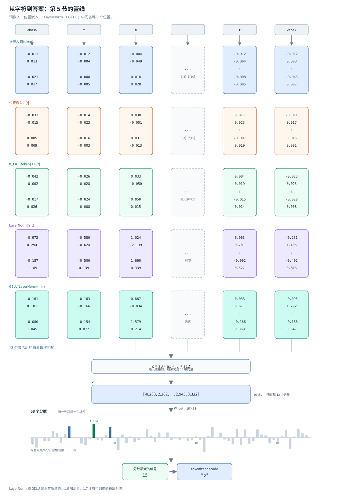
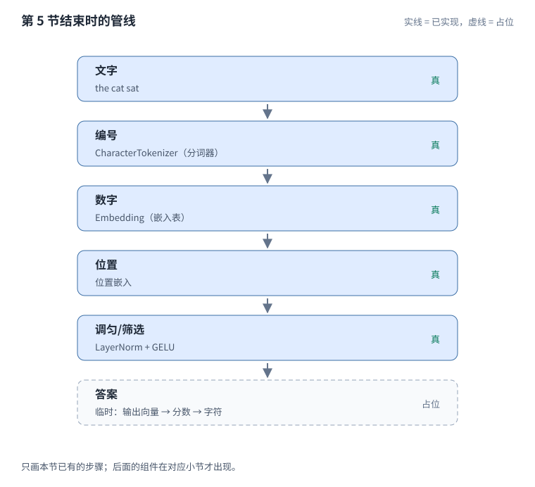
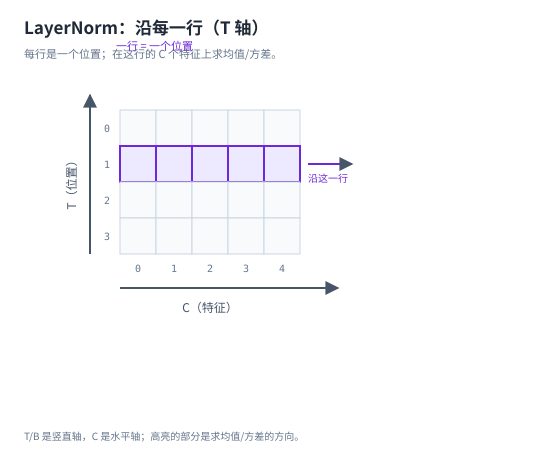
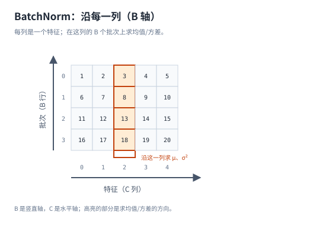
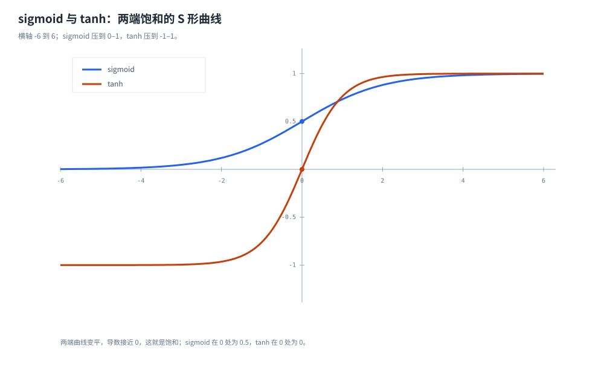
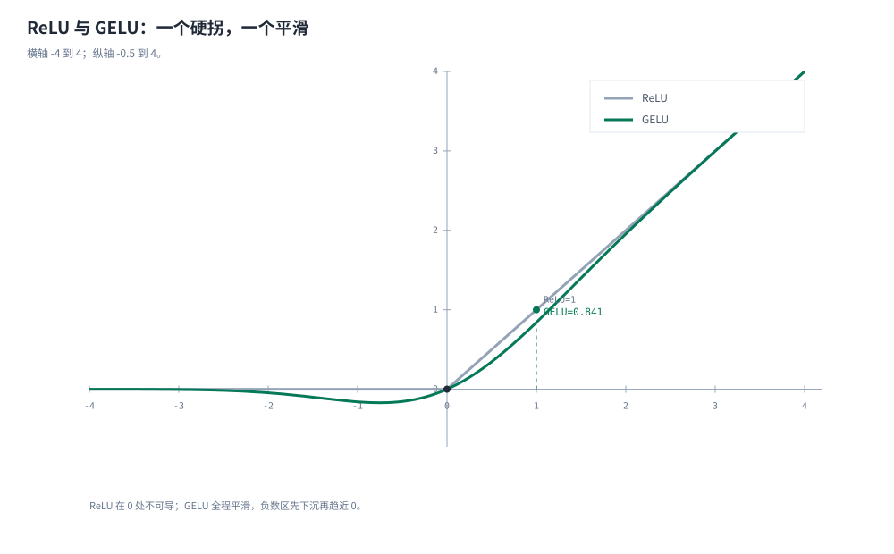
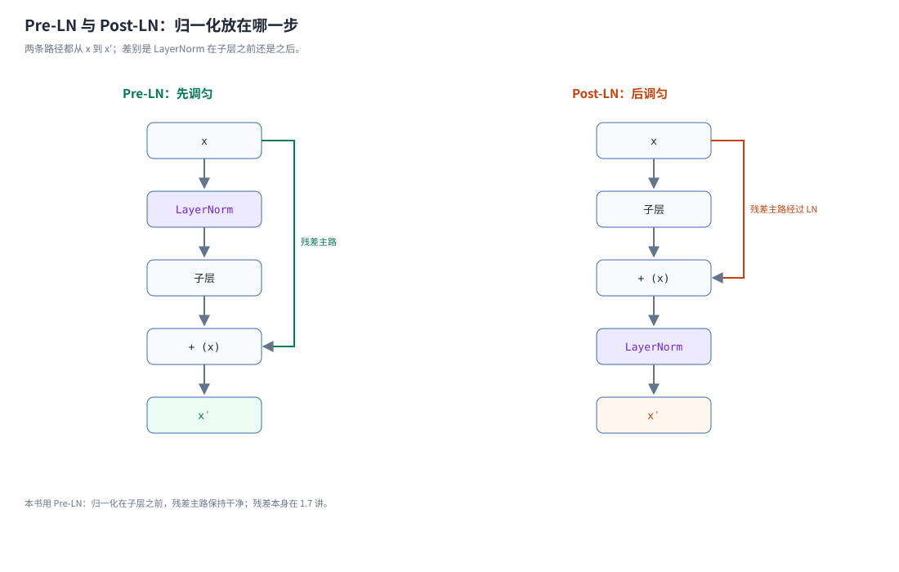

# 1.5 LayerNorm 与 GELU

1.4 的每个位置已经有一行 16 个数字，但这 16 个数字的尺度会随输入变化：有的行整体偏大，有的行整体偏小。这一节加两个逐位置的步骤：先把每行数字标准化，再用一个平滑的激活函数筛选。它们合起来就是架构图里的“调匀/筛选”。

## LayerNorm：把每个位置的数字调匀

### 问题：不同位置的数值尺度不一

嵌入表和位置表都是随机初始化的，相加后的 16 个数字可能整体很大，也可能整体很小。后面的层如果直接吃这些数，大数会主导计算；而且不同位置的尺度不同，模型很难用同一套规则处理。标准化把每一行拉到相近的尺度：均值为 0、方差为 1，再由可学习的增益和偏置调整。

### 名字：LayerNorm 的 layer 是什么

LayerNorm 是 Layer Normalization（层归一化）的缩写。`layer` 不是说“对整层所有位置一起算”，而是对**每个位置自己的最后一维**算：一个位置有 16 个特征，就在这 16 个数上求均值和方差。它不跨位置，也不跨批次；所以 13 个位置会各自得到 13 组统计量。

对比一下：如果对批次里所有位置一起求统计量，那是另一种做法（BatchNorm）；本书不用它，因为它依赖批次大小，推理时也不好处理单个样本。LayerNorm 对每个位置独立，天然适合 `[T, C]` 这样的形状。

### 定义：每个位置自己做标准化

对一个位置的特征向量 $x \in \mathbb{R}^{C}$（1.3 定义的 16 个数字）：

$$
\begin{aligned}
\mu &= \frac{1}{C}\sum_{i=1}^{C} x_i, \\
\sigma^2 &= \frac{1}{C}\sum_{i=1}^{C}(x_i-\mu)^2, \\
y_i &= \frac{x_i-\mu}{\sqrt{\sigma^2+\epsilon}}\,g_i + b_i.
\end{aligned}
$$

`C = 16`；$\epsilon$ 是防止除以零的小数（`eps = 1e-5`）；$g_i$ 和 $b_i$ 是可学习的增益和偏置，初始分别为 1 和 0。方差除以 $C$，不是 $C-1$，这是总体方差。

输入形状是 `[..., C]`，输出形状不变；本章示例用一条序列 `[T, C]`，1.4 介绍的 `[B, T, C]` 也能直接传进来，因为 LayerNorm 只看最后一维。每个位置独立计算，位置之间不交换信息。增益和偏置各有 16 个数字，所以一个 LayerNorm 有 32 个数字；一个 block 有两个 LayerNorm（1.7 讲），共 64 个数字。

### 最小例子

对 `[1, 2, 3, 4]` 做 LayerNorm（增益 1、偏置 0）：

- 均值 $\mu = (1+2+3+4)/4 = 2.5$
- 方差 $\sigma^2 = ((-1.5)^2+(-0.5)^2+0.5^2+1.5^2)/4 = 1.25$
- 标准差 $\sqrt{1.25} \approx 1.118$
- 输出约为 `[-1.342, -0.447, 0.447, 1.342]`

输出的均值是 0，方差是 1；原来的 1、2、3、4 被拉成了以 0 为中心的四段。

### `LayerNorm` 的用法与签名

`LayerNorm(normalized_shape)` 构造；`forward(inputs)` 对最后一维做标准化。输入 `[..., C]`，输出同形状；最后一维必须等于 `normalized_shape`，否则报错。

```text
>>> layer_norm = LayerNorm(4)
>>> layer_norm.forward(torch.tensor([1.0, 2.0, 3.0, 4.0])).tolist()
[-1.342, -0.447, 0.447, 1.342]
```

```python
def __init__(
    self,
    normalized_shape: int,
    *,
    eps: float = 1e-5,
    dtype: torch.dtype = torch.float32,
) -> None:
    # 建立增益和偏置
    ...

def forward(self, inputs: torch.Tensor) -> torch.Tensor:
    # 在最后一维求均值/方差，标准化后缩放平移
    ...
```

## GELU：平滑的激活

### 名字：Gaussian Error Linear Unit

GELU 是 Gaussian Error Linear Unit（高斯误差线性单元）的缩写。它把输入 $x$ 乘上“$x$ 大于随机高斯噪声的概率”，也就是高斯分布的累积分布函数 $\Phi(x)$：

$$
\operatorname{GELU}(x) = x\,\Phi(x)
= \frac{x}{2}\left(1+\operatorname{erf}\left(\frac{x}{\sqrt{2}}\right)\right)
$$

`erf` 是误差函数（error function），所以名字里有 Gaussian 和 Error；`Linear Unit` 指它保留了输入的线性部分。实际实现常用下面的 tanh 近似，计算起来更快：

$$
\operatorname{GELU}(x)
\approx \frac{x}{2}\left(1+\tanh\left(\sqrt{\frac{2}{\pi}}\,(x+0.044715x^3)\right)\right)
$$

本书的 `GELU` 用这个近似式；它在常用区间与精确式的差别在千分之一量级。

GELU 和 ReLU 的来历、定义和对比放在扩展阅读；这里先记住它在 1 处约 0.841，而不是 ReLU 的 1。

### `GELU` 的用法与签名

`GELU()` 没有可学习参数；`forward(inputs)` 逐元素计算，输入输出形状相同。

```text
>>> GELU().forward(torch.tensor([-10.0, 0.0, 1.0, 10.0])).tolist()
[-0.0, 0.0, 0.8412, 10.0]
```

```python
def forward(self, inputs: torch.Tensor) -> torch.Tensor:
    # 逐元素套用 tanh 近似
    ...
```

## Pre-LN：先调匀再进子层

1.6 的混合和 1.7 的 MLP 都是“子层”。Pre-LN 指先对输入做 LayerNorm，再送进子层，最后加回原输入：

```text
x = x + sublayer(LayerNorm(x))
```

对应的 Post-LN 是“先子层、再归一化”：

```text
x = LayerNorm(x + sublayer(x))
```

本书选 Pre-LN：归一化在残差分支之前，训练时更稳定，深层堆叠更容易。残差本身在 1.7 讲；这里只需要记住顺序：**先调匀，再进子层**。一个 block 有两个子层，所以有两个 LayerNorm，共 $2 \times 32 = 64$ 个数字。

## 本节需要实现的函数

本节实现 `LayerNorm` 和 `GELU` 两个零件；它们都按最后一维 `C` 工作：既能处理 `[T, C]`，也能处理 1.4 介绍的 `[B, T, C]`。示例仍按一条序列 `[T, C]` 写；1.7 的 block 会把它们放到残差和子层里。

### `LayerNorm.__init__`

`LayerNorm(normalized_shape)` 建立两个长度为 `normalized_shape` 的向量：`gain` 全是 1，`bias` 全是 0。`normalized_shape` 是最后一维的大小（本章 16）；`eps` 默认 `1e-5`。

```text
>>> layer_norm = LayerNorm(16)
>>> layer_norm.gain.shape, layer_norm.bias.shape
(torch.Size([16]), torch.Size([16]))
```

### `LayerNorm.forward`

输入 `[..., 16]`，输出同形状。对每个位置：求最后一维的均值 $\mu$ 和总体方差 $\sigma^2$，用 $\sqrt{\sigma^2+\epsilon}$ 标准化，再乘 `gain`、加 `bias`。最后一维不是 16 时报 `ValueError`。

### `GELU.forward`

输入任意形状，输出同形状；逐元素套用 tanh 近似。没有可学习参数。

## 参考实现

```python
class LayerNorm:
    def __init__(
        self,
        normalized_shape: int,
        *,
        eps: float = 1e-5,
        dtype: torch.dtype = torch.float32,
    ) -> None:
        if normalized_shape <= 0:
            raise ValueError("normalized_shape must be positive")
        self.normalized_shape = normalized_shape
        self.eps = eps
        self.gain = torch.ones(normalized_shape, dtype=dtype)
        self.bias = torch.zeros(normalized_shape, dtype=dtype)

    def forward(self, inputs: torch.Tensor) -> torch.Tensor:
        if inputs.shape[-1] != self.normalized_shape:
            raise ValueError("last dimension does not match normalized_shape")
        mean = inputs.mean(dim=-1, keepdim=True)
        variance = inputs.var(dim=-1, unbiased=False, keepdim=True)
        normalized = (inputs - mean) / torch.sqrt(variance + self.eps)
        return normalized * self.gain + self.bias


class GELU:
    def forward(self, inputs: torch.Tensor) -> torch.Tensor:
        cubic = inputs.pow(3)
        inner = math.sqrt(2.0 / math.pi) * (inputs + 0.044715 * cubic)
        return 0.5 * inputs * (1.0 + torch.tanh(inner))
```

占位管线在 stage 5 用同样的两步，接在 1.4 的向量后面：

```python
layer_norm = LayerNorm(WIDTH)
gelu = GELU()
vectors = gelu.forward(layer_norm.forward(vectors))
```

## 每个函数的结果

### `LayerNorm`

`LayerNorm(4)` 对 `[1, 2, 3, 4]` 输出 `[-1.342, -0.447, 0.447, 1.342]`；均值 0、方差 1。把 `gain` 设成 2、`bias` 设成 1，均值变成 1、方差变成 4，说明增益和偏置是在标准化之后作用的。

### `GELU`

`GELU()` 对 `[-10, 0, 1, 10]` 输出 `[0, 0, 0.8412, 10]`。和 ReLU 相比，1 处的值略小，负数处不是硬 0，而是平滑地趋近 0。

### 占位管线的 stage 5

```bash
cd ch01/end
uv run python scripts/show_placeholder.py --stage 5 "the cat sat"
```

输出：

```text
stage 5 | text: the cat sat
ids (13)        [66, 19, 7, 4, 52, 2, 0, 19, 52, 18, 0, 19, 67]
positions       (13, 16)
vectors         (13, 16)
output          [-0.283, 2.282, 2.75, 6.084, 4.483, 1.812, 3.895, 2.782, 4.987, 3.712, 3.021, 2.832, 6.751, 7.676, 2.945, 3.322]
scores          68 | max 4.154 at 15
answer          15
character       'p'
```

`vectors` 是 13 行经过 LayerNorm 和 GELU 后的向量；输出向量与 1.4 不同（最高分从 0.125 变成 4.154），答案也从编号 21、字符 `v` 变成编号 15、字符 `p`。这不是模型变准了，而是这两步改变了数字；权重仍然是随机初始化的。

## 本节结束后的管线



*图 1.5-1：词嵌入 + 位置嵌入 → LayerNorm → GELU → 求和 → 输出矩阵 → 分数 → 编号/字符。图中省略中间 8 个位置；LayerNorm 和 GELU 是本节新增的。*



*图 1.5-2：第 5 节结束时的管线。位置、调匀/筛选都是实线；答案仍来自固定输出矩阵。*

13 个位置各自做 LayerNorm 和 GELU，位置之间不交换信息；混合要到 1.6。输出向量、分数和答案都变了，但整条链路的形状没变：仍然是 13 个位置、每个 16 个数字，最后映射到 68 个分数。

## 验收

- `cd ch01/end && uv run pytest -q` 现在是 **34 passed, 1 failed**；失败的是 1.6 和 1.7 的两个结构测试。
- `tests/test_layers.py` 有 10 项通过：4 项嵌入、4 项 LayerNorm、2 项 GELU。
- `tests/test_placeholder.py` 的 stage 5 通过：`vectors` 等于 GELU(LayerNorm(token + position))。
- `uv run python scripts/show_placeholder.py --stage 5 "the cat sat"` 输出 `answer 15`、`character 'p'`。

## 扩展阅读：两个零件从哪里来

LayerNorm 和 GELU 都不是“先有名字、再找用途”的零件。它们各自有一段从失败中长出来的历史：归一化原来是为了让很深的卷积网络训得动，激活函数原来是为了让梯度不要消失。理解这段历史，会更容易记住它们为什么长成现在这样。

### 归一化：从 BatchNorm 到 LayerNorm

2015 年，Ioffe 和 Szegedy 在训练很深的卷积网络时遇到一个现象：每一层的输入分布会随着前面层的参数更新而不断变化。他们把这种现象叫作内部协变量偏移（internal covariate shift），并提出 BatchNorm（批归一化）：在一个批次里，对同一个特征通道的所有样本求均值和方差，把该通道的标准差拉回 1 附近。

BatchNorm 在卷积网络里非常有效，但它有一个前提：批次要足够大。批次太小，均值和方差的估计会抖动；训练和推理还不一样——训练时用当前批次的统计量，推理时要用训练期间累积的 running statistics。对一条序列、一个样本做推理时，这个前提尤其别扭。

2016 年，Ba、Kiros 和 Hinton 换了一个方向：不对批次求统计量，而对**每个位置自己的特征维**求。这就是 LayerNorm（层归一化）。它不依赖批次大小，训练和推理用同一套公式，单条序列也能算。第二年的 Transformer 论文把 LayerNorm 放进每个子层，从此它成了 transformer 的标配。

两者的差别在于统计量沿哪个轴求：LayerNorm 在 `[T, C]` 上沿 **C（特征）** 对每个位置求；BatchNorm 在 `[B, C]` 上沿 **B（批次）** 对每个特征求（实际输入是 `[B, T, C]`，统计时把 B 和 T 都当作样本）。图 1.5-3 用两张图分别画出这两个轴。

<div class="figure-pair">
<figure>

<figcaption>图 1.5-3a：LayerNorm 在 <code>[T, C]</code> 上沿 <strong>C（特征）</strong> 求均值/方差；每一行是一个位置。</figcaption>
</figure>
<figure>

<figcaption>图 1.5-3b：BatchNorm 在 <code>[B, C]</code> 上沿 <strong>B（批次）</strong> 求均值/方差；每一列是一个特征。</figcaption>
</figure>
</div>

本章示例按一条序列讲，没有用批次维；LayerNorm 也支持 `[B, T, C]`，所以用前者。

LayerNorm 的公式就是本章前面那三行：先求行均值 $\mu$ 和行方差 $\sigma^2$，再标准化，最后乘增益 $g$、加偏置 $b$。增益和偏置让模型可以“撤销”一部分标准化——如果某一维本来就应该大一点，学到的 $g$ 会把它放大。`eps` 则负责兜底：当一行所有数都相同、方差为 0 时，分母不会变成 0。

BatchNorm 并没有消失。它在卷积网络、非常大的批次、以及一些视觉模型里仍然常见；LayerNorm 则在 transformer、RNN、以及批次很小或没有批次的场景里更自然。选择哪个，本质上是在问：**统计量沿哪一维求，才对当前任务有意义？**

### 激活函数：从 sigmoid 到 ReLU 到 GELU

最早的神经元模型用阶跃函数：输入超过阈值就输出 1，否则输出 0。阶跃不可导，训练时没法求梯度；于是 sigmoid（S 形函数）和 tanh（双曲正切）登场，把输出压到 0–1 或 -1–1，既平滑又有导数。它们在很长一段时间里是标准配置。
sigmoid 和 tanh 的定义是：

$$
\sigma(x) = \frac{1}{1+e^{-x}},
\qquad
\tanh(x) = \frac{e^x-e^{-x}}{e^x+e^{-x}}
$$

图 1.5-4 画出它们的曲线：sigmoid 从 0 升到 1，tanh 从 -1 升到 1；两条曲线在两端都变得很平，这就是“饱和”。



*图 1.5-4：sigmoid（蓝）和 tanh（橙）在 -6 到 6 的曲线。sigmoid 的值域是 0–1，tanh 是 -1–1；两端都趋于平缓，导数接近 0。*


但 sigmoid 和 tanh 在两端会“饱和”：输入很大或很小时，曲线几乎水平，导数接近 0。网络一深，梯度从后往前乘，越乘越小，这就是梯度消失。2010 年前后，Nair 和 Hinton、以及 Glorot 等人重新推广了 ReLU（Rectified Linear Unit，线性整流单元）：

$$
\operatorname{ReLU}(x) = \max(0, x)
$$

ReLU 的正半轴是一条直线，导数恒为 1，梯度不会在正区间衰减；负数直接变 0，还带来稀疏性。它让很深的网络变得可训练，成为卷积网络和早期 transformer 的默认选择。

ReLU 也有自己的问题：负数区导数为 0，如果一个神经元的输入长期落在负数区，它的参数就再也收不到梯度，俗称“死亡 ReLU”。为了保留 ReLU 的简单，又让负数区有一点坡度，研究者提出了 Leaky ReLU、PReLU、ELU 等变体。

GELU 是另一条路。2016 年，Hendrycks 和 Gimpel 注意到：与其硬性决定“负数就丢掉”，不如让每个输入乘上“它大于一个随机高斯噪声的概率”。这个概率就是高斯分布的累积分布函数 $\Phi(x)$，于是

$$
\operatorname{GELU}(x) = x\,\Phi(x)
= \frac{x}{2}\left(1+\operatorname{erf}\left(\frac{x}{\sqrt 2}\right)\right)
$$

`erf` 是误差函数，名字里的 Gaussian 和 Error 就来自这里。实际实现常用 tanh 近似（本章代码用的就是它）。图 1.5-5 把 ReLU 和 GELU 画在一起：ReLU 在 0 处有一个硬拐角，GELU 则是平滑过渡；负数区 ReLU 是 0，GELU 会先下沉一点，再趋近 0。



*图 1.5-5：ReLU（灰）与 GELU（绿）在 -4 到 4 的曲线。ReLU 在 0 处不可导；GELU 全程平滑，负数区有一个很小的负值。*

几个关键点的对比：

|输入|-10|0|1|10|
|---|---|---|---|---|
|ReLU|0|0|1|10|
|GELU|≈0|0|0.841|10|

在 1 处，ReLU 原样通过，GELU 只通过约 84%；在负数区，GELU 不是硬 0，而是平滑地压向 0。这种平滑让梯度更连续，也让 GELU 在 BERT、GPT 等模型里流行起来。代价是计算比 ReLU 稍贵：`erf` 或 `tanh` 都比一次比较和取最大值复杂。

### Pre-LN 与 Post-LN：顺序为什么重要

2017 年的原始 Transformer 用的是 Post-LN：先做子层和残差，再做 LayerNorm。公式是

$$
x' = \operatorname{LayerNorm}\bigl(x + \operatorname{sublayer}(x)\bigr)
$$

这种顺序在浅层模型里工作得很好，但层数一多，训练会变得敏感；原论文不得不用 learning rate warmup（先小后大）来稳住早期训练。

后来 GPT-2 一类的模型改成了 Pre-LN：先 LayerNorm，再进子层，最后加残差。

$$
x' = x + \operatorname{sublayer}\bigl(\operatorname{LayerNorm}(x)\bigr)
$$

这样归一化在残差分支之前，残差主路始终保持一条“干净”的通道，梯度可以更直接地回传。Xiong 等人在 2020 年分析了这两种顺序：Post-LN 在深层时需要 warmup，Pre-LN 对 warmup 的依赖小得多。图 1.5-6 把两条路径并排画了出来。



*图 1.5-6：Pre-LN 把 LayerNorm 放在子层之前，残差主路不经过归一化；Post-LN 先加残差再归一化。本书选 Pre-LN。*

本书的 block 用 Pre-LN：每个子层前一个 LayerNorm，残差在 1.7 讲。这样安排不是为了追新，而是因为小模型也要堆两层，Pre-LN 的训练行为更可控；第 3 章实现反向传播时，会看到归一化位置对梯度的影响。

### 本书为什么选这一套

把三个选择放在一起看：

- **LayerNorm 而不是 BatchNorm**：本章示例按一条序列讲，没有用批次维；LayerNorm 对每个位置独立，也支持 1.4 的 `[B, T, C]`，训练和推理公式一致。
- **GELU 而不是 ReLU**：GELU 平滑，负数区不是硬截断；它和 BERT/GPT 的选择一致，便于后面章节对照。
- **Pre-LN 而不是 Post-LN**：归一化在子层之前，残差主路干净，深层堆叠更稳。

这些选择都不是“唯一正确”，而是针对本书的小模型、单序列示例和后续训练章节做的权衡。理解它们的历史和取舍，比记住“transformer 就用这个”更有用。

### 参考文献

- Ioffe, S., & Szegedy, C. (2015). *Batch Normalization: Accelerating Deep Network Training by Reducing Internal Covariate Shift.* ICML.
- Ba, J. L., Kiros, J. R., & Hinton, G. E. (2016). *Layer Normalization.* arXiv:1607.06450.
- Vaswani, A., et al. (2017). *Attention Is All You Need.* NeurIPS.
- Radford, A., et al. (2019). *Language Models are Unsupervised Multitask Learners.*（GPT-2）
- Xiong, R., et al. (2020). *On Layer Normalization in the Transformer Architecture.* ICML.
- Nair, V., & Hinton, G. E. (2010). *Rectified Linear Units Improve Restricted Boltzmann Machines.* ICML.
- Glorot, X., Bordes, A., & Bengio, Y. (2011). *Deep Sparse Rectifier Neural Networks.* AISTATS.
- Clevert, D.-A., Unterthiner, T., & Hochreiter, S. (2015). *Fast and Accurate Deep Network Learning by Exponential Linear Units (ELUs).* ICLR.
- Hendrycks, D., & Gimpel, K. (2016). *Gaussian Error Linear Units (GELUs).* arXiv:1606.08415.
- Devlin, J., et al. (2018). *BERT: Pre-training of Deep Bidirectional Transformers for Language Understanding.* NAACL.
