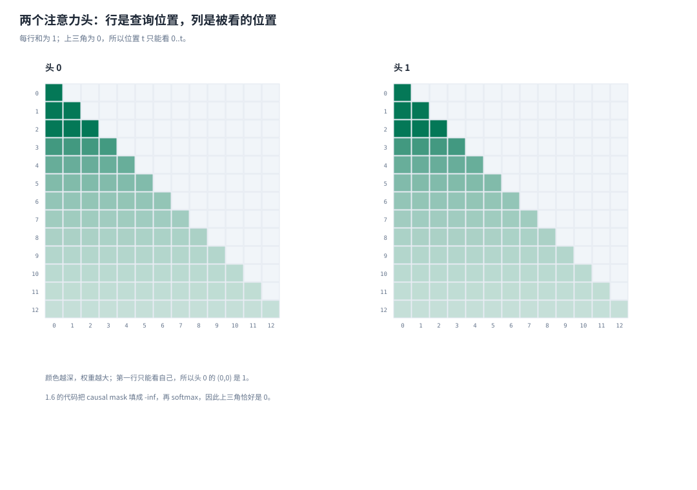
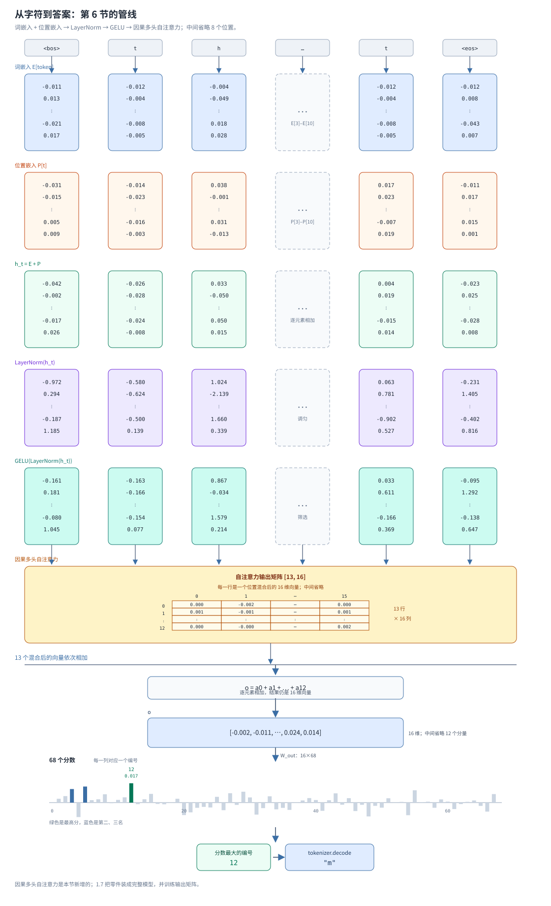

# 1.6 因果多头自注意力

1.5 的 LayerNorm 和 GELU 都是逐位置计算的：第 3 个位置只整理自己的 16 个数字，完全不知道第 0、1、2 个位置是什么。可语言不是一堆独立的字；“cat” 的意思取决于它前面的 “the”，也取决于它后面的 “sat”。这一节加入**注意力**，让每个位置去看它前面的位置，并把看到的信息混进自己的向量。

## 为什么需要注意力

### 问题：每个位置单独算，看不到别的字

如果每个位置只经过逐位置的变换，模型看到的是 13 组互不相干的数字。它无法知道 “the” 在 “cat” 前面，也无法知道当前是在句首还是句尾。要预测下一个字，必须让位置之间交换信息。

### 思路：让每个位置查询其他位置

注意力借用数据库查询的比喻：每个位置发出一个**查询**（query），每个位置也提供一个**键**（key）和一个**值**（value）。查询和键越匹配，这个位置就越应该看对方的值；把看过的值按匹配程度加权求和，就得到这个位置的新向量。

“自”注意力（self-attention）指 query、key、value 都来自同一串输入；每个位置既查询别人，也被别人查询。

### 名字：query/key/value 的来历

这个比喻来自检索系统：你输入 query，系统拿它和每条记录的 key 比较，返回匹配记录的值。2014 年 Bahdanau 等人把它用于机器翻译，2017 年的 Transformer 把它变成模型的主体；“自注意力”强调 query、key、value 同源，“多头”则是把同一件事并行做几遍。

## Linear：先学一个可训练的矩阵乘法

### 定义

1.3 的输出矩阵 `W_out` 已经把 16 维向量变成 68 个分数；那时它是固定的。`Linear` 把同样的矩阵乘法抽象成一个可训练的层：

$$
Y = XW + b
$$

`X` 是 `[..., in_features]`，`W` 是 `[in_features, out_features]`，`b` 是 `[out_features]`，`Y` 是 `[..., out_features]`。和 1.3 的 `W_out` 相比，多了一个偏置 `b`，而且 `W`、`b` 会在训练中调整（第 3 章）。

### `Linear` 的用法与签名

`Linear(in_features, out_features)` 构造；`forward(inputs)` 做矩阵乘法。输入最后一维必须等于 `in_features`。

```text
>>> linear = Linear(3, 2)
>>> linear.weight.shape, linear.bias.shape
(torch.Size([3, 2]), torch.Size([2]))
>>> linear.forward(torch.zeros(4, 3)).shape
torch.Size([4, 2])
```

```python
def __init__(
    self,
    in_features: int,
    out_features: int,
    *,
    generator: torch.Generator | None = None,
    dtype: torch.dtype = torch.float32,
) -> None:
    # 建立 weight 和 bias
    ...

def forward(self, inputs: torch.Tensor) -> torch.Tensor:
    # inputs @ weight + bias
    ...
```

## 自注意力：Q/K/V

### 投影

把输入 `X`（`[T, C]`）分别送进三个 `Linear`，得到 query、key、value：

$$
Q = XW_Q + b_Q,\quad K = XW_K + b_K,\quad V = XW_V + b_V
$$

三个投影的形状都是 `[T, C]`；它们各自的 `W` 不同，所以同一个位置可以扮演不同的角色。

### 拆头

本章 `C = 16`、`H = 2` 个头，每个头 `D = C / H = 8`。把 `[T, 16]` 拆成 `[T, 2, 8]`，再转置成 `[2, T, 8]`；两个头各自独立算一套注意力。

### 打分与缩放

每个头的 query 和所有 key 做点积，得到 `[T, T]` 的分数：

$$
S = \frac{QK^\top}{\sqrt{D}}
$$

除以 $\sqrt{D}$ 是为了让分数不要随维度变大而爆炸；否则 softmax 会变得极端。

### 因果掩码

语言模型不能看未来。位置 $t$ 只能看 $0..t$，不能看 $t+1$ 及以后。做法是把上三角（$j > i$）的分数改成 $-\infty$，再 softmax；这样那些位置的权重恰好是 0。



*图 1.6-1：13×13 的因果注意力权重，两个头各一张。上三角为 0，所以位置 t 只能看 0..t；每行权重和为 1。*

### softmax 与加权求和

对每一行做 softmax：

$$
A_{ij} = \frac{\exp(S_{ij})}{\sum_{k}\exp(S_{ik})}
$$

再把权重和 value 相乘：

$$
O = AV
$$

`O` 的形状是 `[H, T, D]`；把两个头拼回 `[T, C]`，再过一次输出投影 `out_proj`，得到这一层的输出。

## 多头

一个头只能学一种“关注方式”；多个头可以分别关注相邻位置、句首、标点等不同模式。两个头各自算 Q/K/V、各自 softmax，最后拼接。多头不增加序列长度，只把 16 维分成 2 份，每份 8 维。

`MultiHeadSelfAttention` 的四个投影各是一个 `Linear(C, C)`，所以参数量是 $4 \times (C \times C + C)$；本章是 $4 \times (256 + 16) = 1088$。

## 本节需要实现的函数

### `Linear.__init__` / `forward`

构造时建立 `weight`（`[in, out]`，初始乘 0.02）和 `bias`（`[out]`，初始 0）；前向做 `inputs @ weight + bias`，最后一维不等于 `in_features` 时报错。

### `MultiHeadSelfAttention.__init__`

检查 `d_model % n_heads == 0`，建立 `q_proj`、`k_proj`、`v_proj`、`out_proj` 四个 `Linear`，并记下 `n_heads` 和 `head_dim`。

### `MultiHeadSelfAttention.forward`

输入 `[T, C]`（也支持 `[B, T, C]`），返回 `(output, cache)`；`cache` 里有 `q`、`k`、`v`、`weights`，供 1.8/1.9 逐层展示。步骤：投影 → 拆头 → 打分/缩放 → 因果掩码 → softmax → 加权求和 → 拼头 → 输出投影。

## 参考实现

```python
class Linear:
    def __init__(
        self,
        in_features: int,
        out_features: int,
        *,
        generator: torch.Generator | None = None,
        dtype: torch.dtype = torch.float32,
    ) -> None:
        if in_features <= 0 or out_features <= 0:
            raise ValueError("linear dimensions must be positive")
        self.in_features = in_features
        self.out_features = out_features
        self.weight = (
            torch.randn(in_features, out_features, generator=generator, dtype=dtype)
            * 0.02
        )
        self.bias = torch.zeros(out_features, dtype=dtype)

    def forward(self, inputs: torch.Tensor) -> torch.Tensor:
        if inputs.shape[-1] != self.in_features:
            raise ValueError("last dimension does not match in_features")
        return inputs @ self.weight + self.bias
```

```python
class MultiHeadSelfAttention:
    def __init__(
        self,
        d_model: int,
        n_heads: int,
        *,
        generator: torch.Generator | None = None,
        dtype: torch.dtype = torch.float32,
    ) -> None:
        if d_model <= 0 or n_heads <= 0:
            raise ValueError("d_model and n_heads must be positive")
        if d_model % n_heads != 0:
            raise ValueError("d_model must be divisible by n_heads")
        self.d_model = d_model
        self.n_heads = n_heads
        self.head_dim = d_model // n_heads
        self.q_proj = Linear(d_model, d_model, generator=generator, dtype=dtype)
        self.k_proj = Linear(d_model, d_model, generator=generator, dtype=dtype)
        self.v_proj = Linear(d_model, d_model, generator=generator, dtype=dtype)
        self.out_proj = Linear(d_model, d_model, generator=generator, dtype=dtype)

    def forward(
        self, inputs: torch.Tensor
    ) -> tuple[torch.Tensor, dict[str, torch.Tensor]]:
        if inputs.shape[-1] != self.d_model:
            raise ValueError("last dimension does not match d_model")
        q = self.q_proj.forward(inputs)
        k = self.k_proj.forward(inputs)
        v = self.v_proj.forward(inputs)

        def split_heads(states: torch.Tensor) -> torch.Tensor:
            states = states.reshape(*states.shape[:-1], self.n_heads, self.head_dim)
            return states.transpose(-3, -2)

        q = split_heads(q)
        k = split_heads(k)
        v = split_heads(v)
        scores = q @ k.transpose(-2, -1) / math.sqrt(self.head_dim)
        length = inputs.shape[-2]
        causal = torch.triu(
            torch.ones(length, length, dtype=torch.bool, device=inputs.device),
            diagonal=1,
        )
        scores = scores.masked_fill(causal, float("-inf"))
        weights = torch.softmax(scores, dim=-1)
        attended = weights @ v
        attended = attended.transpose(-3, -2).reshape(*inputs.shape)
        output = self.out_proj.forward(attended)
        return output, {"q": q, "k": k, "v": v, "weights": weights}
```

占位管线在 stage 6 接上注意力：

```python
attention = MultiHeadSelfAttention(WIDTH, 2, generator=...)
vectors, attention_cache = attention.forward(vectors)
```

## 每个函数的结果

### `Linear`

`Linear(3, 2)` 的 `weight` 是 `[3, 2]`、`bias` 是 `[2]`；输入 `[4, 3]` 输出 `[4, 2]`。把 `bias` 设成 `[1, -1]`，输入全 0 时输出就是 `[[1, -1]]`。

### `MultiHeadSelfAttention`

输入 `[5, 16]`，`n_heads=2` 时输出 `[5, 16]`；`cache["q"]` 是 `[2, 5, 8]`，`cache["weights"]` 是 `[2, 5, 5]`。每行权重和为 1；上三角为 0。把最后一个位置改掉，前面位置的输出不变——这就是因果性。

### 占位管线的 stage 6

```bash
cd ch01/end
uv run python scripts/show_placeholder.py --stage 6 "the cat sat"
```

输出：

```text
stage 6 | text: the cat sat
ids (13)        [66, 19, 7, 4, 52, 2, 0, 19, 52, 18, 0, 19, 67]
positions       (13, 16)
vectors         (13, 16)
output          [-0.002, -0.011, 0.02, -0.019, -0.026, 0.017, -0.021, 0.015, 0.007, 0.004, -0.006, 0.024, 0.004, 0.003, 0.024, 0.014]
attention       (2, 13, 13)
scores          68 | max 0.017 at 12
answer          12
character       'm'
```

`vectors` 是 13 行经过注意力后的向量；`attention` 是两个头各自的 13×13 权重。输出向量和 1.5 不同（最高分从 4.154 变成 0.017），答案也从编号 15、字符 `p` 变成编号 12、字符 `m`；权重仍然是随机初始化的，数字没有语义。

## 本节结束后的管线



*图 1.6-2：词嵌入 + 位置嵌入 → LayerNorm → GELU → 因果多头自注意力 → 求和 → 输出矩阵 → 分数 → 编号/字符。图中省略中间 8 个位置；注意力是本节新增的。*


*图 1.6-3：第 6 节结束时的管线。调匀/筛选、混合都是实线；答案仍来自固定输出矩阵。*

注意力让 13 个位置互相交换信息，但每个位置只能看自己和它前面的位置；因果掩码保证这一点。1.7 会把 LayerNorm、GELU、注意力和 MLP 装成完整的 block，并把输出矩阵换成可训练的。

## 验收

- `cd ch01/end && uv run pytest -q` 现在是 **34 passed, 1 failed**；只剩 1.7 的整模型形状测试。
- `tests/test_structure.py::test_causal_mask_hides_future` 通过：改后面的字不影响前面的输出。
- `tests/test_structure.py::test_attention_shapes_and_row_sums` 通过：每头权重行和为 1。
- `tests/test_structure.py::test_attention_is_causal` 通过：上三角权重为 0。
- `tests/test_layers.py` 有 12 项通过（新增 2 项 `Linear`）。
- `tests/test_placeholder.py` 的 stage 6 通过：`vectors` 等于注意力输出，`attention_weights` 是 `[2, 13, 13]`。
- `uv run python scripts/show_placeholder.py --stage 6 "the cat sat"` 输出 `answer 12`、`character 'm'`。

## 扩展阅读：注意力从哪里来，Q/K/V 为什么缺一不可

Q/K/V 不是 transformer 发明的。它们来自更早的检索和翻译系统：先有一个“我想找什么”的 query，再拿它和一堆 key 比较，最后按匹配程度读取 value。理解这个原始用法，才能看清自注意力里三个量各自负责什么，以及为什么一个都不能省。

### 原始用法：一次“软”检索

想象一个很小的饮料检索器。用户输入 query“我渴了，想找能喝的东西”；系统里有三个 key：水、咖啡、茶；每个 key 对应一个 value：矿泉水、拿铁、龙井。系统先算 query 和每个 key 的匹配分数，再把分数变成权重，最后按权重把三个 value 混在一起。

图 1.6-4 画的就是这个过程：水得到 0.7，咖啡 0.2，茶 0.1；输出是 0.7 × 矿泉水 + 0.2 × 拿铁 + 0.1 × 龙井。它不是“只选一个”，而是“按相关程度混合”，所以叫“软”检索。

<div class="figure-pair">
<figure>

<figcaption>图 1.6-4：query 负责“问”，key 负责“标签”，value 负责“内容”。三者可以来自不同的表。</figcaption>
</figure>
<figure>

<figcaption>图 1.6-5：自注意力把同一个 X 投影成 Q/K/V；Q/K 打分，softmax 成权重，再加权 V。</figcaption>
</figure>
</div>

2014 年，Bahdanau 等人在机器翻译里用了同样的结构：解码器每生成一个词，就发出一个 query，去和编码器每个位置的 key 比较，再读取对应的 value。那时 query 来自解码器，key/value 来自编码器，所以叫“交叉注意力”；2017 年的 Transformer 让 query、key、value 都来自同一串输入，才叫“自注意力”。

### 变成自注意力：同一个输入，三种角色

自注意力里没有单独的“检索库”。输入是一串 token 向量 `X`（`[T, C]`），我们用三个不同的 `Linear` 把它投影成三套向量：

$$
Q = XW_Q + b_Q,\quad K = XW_K + b_K,\quad V = XW_V + b_V
$$

图 1.6-5 画了这个过程。Q、K、V 的形状都是 `[T, C]`，但它们的 `W` 不同，所以同一个 token 在三个子空间里有不同的表示。接下来的步骤和原始检索一样：Q 和 K 打分，softmax 成权重，权重乘 V，最后过 `out_proj`。

### 为什么不能省掉 Q、K、V 中的任何一个

- **没有 Q**：没有“我想找什么”，就无法和 key 比较，注意力权重无从谈起。
- **没有 K**：没有“我有什么标签”，query 没有比较对象；只剩 value 的话，每个位置只能盲目地平均。
- **没有 V**：权重算出来了，却没有“实际内容”可读；注意力变成了只看关系、不搬运信息。

更关键的是，Q/K 和 V 的分工不能合并。检索系统里，key 是索引标签，value 是网页正文；两者本来就可以不同。自注意力保留这种分离：Q/K 决定“看谁”，V 决定“看到什么”。如果强行让 Q=K，打分矩阵会变得对称，位置只能互相“对称地看”；如果让 K=V，匹配和内容被绑死，模型就没法“用 A 的标签去取 B 的内容”。Q、K、V 三个投影正是给模型这种自由度。

多头进一步把这件事并行做几遍：每个头有自己的 `W_Q/W_K/W_V`，可以在不同子空间里学不同的“看谁、取什么”。本章 2 个头、每个 8 维，就是最小版本。

### 自注意力之后，Q/K/V 变成了什么

在原始检索里，query/key/value 是外部给定的；在自注意力里，它们是同一批 token 的三个**可学习角色**：

- Q 是“这个位置想找什么”；
- K 是“这个位置能提供什么标签”；
- V 是“这个位置实际贡献什么内容”。

注意力权重是 Q 和 K 的匹配结果，输出是 V 的加权混合。换句话说，自注意力是一个**可微的、内容驱动的软检索**：每个位置根据当前内容决定看哪里，再把看到的内容混进自己的向量。Q/K/V 不再是原始 embedding，而是模型学出来的三种“视角”；`W_Q/W_K/W_V` 和 `out_proj` 都会在训练中调整（第 3 章）。

因果掩码给这个检索加上限制：位置 $t$ 只能查 $0..t$ 的 key，不能查未来。这样训练时才能一次性喂整句，而不让位置 $t$ 偷看 $t+1$。

### 参考文献

- Bahdanau, D., Cho, K., & Bengio, Y. (2014). *Neural Machine Translation by Jointly Learning to Align and Translate.* ICLR.
- Luong, M.-T., Pham, H., & Manning, C. D. (2015). *Effective Approaches to Attention-based Neural Machine Translation.* EMNLP.
- Vaswani, A., et al. (2017). *Attention Is All You Need.* NeurIPS.
- Devlin, J., et al. (2018). *BERT: Pre-training of Deep Bidirectional Transformers for Language Understanding.* NAACL.
