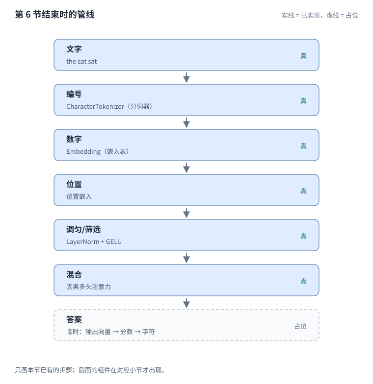
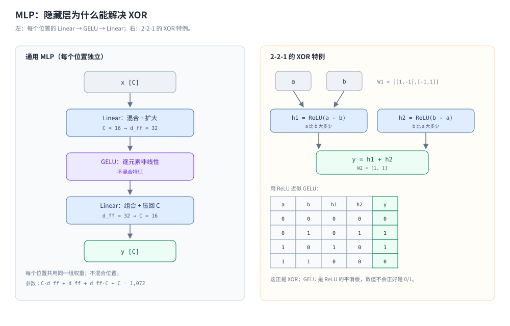

# 1.7 Transformer block

1.6 结束时，管线里已经有一段因果多头自注意力：每个位置按权重读取前面的 $V$。但一个注意力层只负责“把别的位置的信息混进来”，它没有在每个位置上做足够的非线性变换，也没有把多层堆起来。

这一节把 1.5 的 LayerNorm、GELU、1.6 的注意力和新的 MLP 装成一个 Pre-LN **Transformer block**，并算清一个 block 的参数。完整模型、输出层、5,824 个参数和 argmax 在 1.8。

## 问题：一层注意力不够

1.6 的 `MultiHeadSelfAttention` 输入形状为 `[B, T, C]`，输出形状也是 `[B, T, C]`；它内部做 Q/K/V 投影、因果掩码、softmax 和加权求和，返回 `(output, cache)`。它解决的是“位置之间怎样交换信息”，但不解决“每个位置内部怎样把特征再加工一遍”。

如果只有注意力，每个位置的输出仍然是前面若干位置 $V$ 的线性组合；连续堆几层注意力，每层还是在做“按权重混合 $V$”。模型缺少一个逐位置的非线性子层，表达能力会受限。

第二个问题是深度。若一个子层写成 $F(x)$，模型只能不断替换 $x$；层数一多，原始信号和梯度都要穿过一长串变换。**残差连接**（residual connection）把输入直接加回输出：

$$
y = x + F(x)
$$

这条 $x$ 的通路不经过 $F$，形状仍是 `[B, T, C]`；它让深层网络至少能学到“什么都不改”，也给梯度一条短路径。第 3 章讲反向传播时会再展开这一点，本节先用这个直觉。

## 思路：一个 block，两条残差子层

一个 **block**（块，也叫层块）由两个子层组成：先做注意力，再做 MLP（multi-layer perceptron，多层感知机）。每个子层都采用 **Pre-LN**（前置层归一化）：先把输入送进 LayerNorm，再进子层，最后把子层输出加回输入。

$$
\begin{aligned}
x_1 &= x + \operatorname{Attn}(\operatorname{LN}(x)) \\
x_2 &= x_1 + \operatorname{MLP}(\operatorname{LN}(x_1))
\end{aligned}
$$

这里 $x$、$x_1$、$x_2$ 的形状都是 `[B, T, C]`。注意力负责混合位置，MLP 负责逐位置变换；两条残差都保持形状不变。把这样的 block 串两层，就得到本章的深度。

图 1.7-1 和图 1.7-2 对比两种 LayerNorm 位置：

- **Pre-LN**：`x + Sublayer(LayerNorm(x))`；残差主路不经过 LayerNorm，主路干净。
- **Post-LN**：`LayerNorm(x + Sublayer(x))`；残差主路经过 LayerNorm，这是原论文的写法。

<div class="figure-pair">
<figure>

<figcaption>图 1.7-1：Pre-LN。归一化在子层之前，残差主路保持干净。</figcaption>
</figure>
<figure>

<figcaption>图 1.7-2：Post-LN。先加残差再归一化，残差主路经过 LayerNorm。</figcaption>
</figure>
</div>

本章采用 Pre-LN，原因是它更容易训练深：残差主路没有 LayerNorm，梯度可以沿着 $x$ 直接回传。Xiong 等人在 2020 年分析了两种顺序：Post-LN 在好的 warmup 下可以略好，但 Pre-LN 对初始化和学习率更稳；GPT-2 之后的很多 decoder-only 模型采用 Pre-LN。这个取舍在第 3 章训练时会再出现。

图 1.7-3 把 block 展开：$x$ 先过 LayerNorm 1 和注意力，再加回 $x$ 得到 $x_1$；$x_1$ 再过 LayerNorm 2 和 MLP，再加回 $x_1$ 得到 $x_2$。


*图 1.7-3：一个 Pre-LN block。注意力子层和 MLP 子层各有一条残差；两条主路都保持形状 `[B, T, C]`。*

### MLP：逐位置的非线性变换

**问题**：注意力只负责“按权重混合 $V$”。每个位置的输出是若干 $V$ 的线性组合；即使堆几层注意力，模型还是没有对每个位置的特征做一次独立的非线性加工。

用最小例子看。取一条只有 1 个位置的序列，$C=2$，输入 $x=[a,b]$。这时注意力只有一个分数，softmax 后权重是 1，所以输出就是

$$
V = xW_V + b_V
$$

一个仿射函数。堆两层这样的注意力，仍然是两个仿射函数的复合，还是仿射的。它算不出乘积 $a\cdot b$：如果要求 $(0,0)\to 0$、$(1,0)\to 0$、$(0,1)\to 0$、$(1,1)\to 1$，仿射函数 $pa+qb+r$ 会要求 $r=0, p=0, q=0$，但 $p+q+r=1$，矛盾。

只加一个 `Linear` 也不行。两个 `Linear` 连在一起：

$$
(xU_1+c_1)U_2+c_2 = x(U_1U_2) + (c_1U_2+c_2)
$$

仍然是一个仿射映射。异或（XOR）的四个输入 $(0,0)\to 0$、$(0,1)\to 1$、$(1,0)\to 1$、$(1,1)\to 0$ 也拟合不了：仿射函数要满足 $r=0, q=1, p=1, p+q+r=0$，前三式给出 $p=q=1,r=0$，代入第四式得 $2=0$，矛盾。

只加一个逐元素 GELU 也不行：GELU 对每个坐标单独作用，第 0 个输出只看到第 0 个输入，第 1 个输出只看到第 1 个输入。取 $x=[1,0]$ 和 $x=[0,1]$，它们的和都是 1；逐元素输出最多把两个坐标交换，不能在一个坐标里算出 $a+b$。GELU 不混合特征。

**思路**：给每个位置套一个相同的小型前馈网络（feed-forward network，FFN）：先把 $C$ 维特征扩大到一个更宽的隐藏层，做一次线性混合，经过 GELU 的非线性，再线性投影回 $C$ 维。扩大再压回（expand → nonlinear → project）给非线性留出空间；输出宽度仍是 $C$，所以能直接和残差相加。所有位置共用同一组权重，MLP 不在位置之间交换信息；位置混合仍然由注意力负责。

上面的 XOR 正好说明三个部件各自在做什么。取 $C=2$、$d_{\text{ff}}=2$，令

$$
\begin{aligned}
W_1 &= \begin{bmatrix}1&-1\\-1&1\end{bmatrix} \\
b_1 &= 0 \\
W_2 &= \begin{bmatrix}1\\1\end{bmatrix} \\
b_2 &= 0
\end{aligned}
$$

第一个 `Linear` 先算 $[a-b, -a+b]$，把两个特征混在一起；GELU 把负数压掉；第二个 `Linear` 把两个隐藏单元相加：

$$
\begin{aligned}
h &= \operatorname{GELU}([a-b, -a+b]) \\
y &= h_1+h_2
\end{aligned}
$$

用 ReLU 近似 GELU 时，四个输入的结果是：

|$a$|$b$|$h_1$|$h_2$|$y$|
|---|---|---|---|---|
|0|0|0|0|0|
|0|1|0|1|1|
|1|0|1|0|1|
|1|1|0|0|0|

这正是 XOR。GELU 是 ReLU 的平滑版，实际数值不会正好是 0/1；但结构已经能表达这种非线性。第一个 `Linear` 负责混合，GELU 负责非线性，第二个 `Linear` 负责组合并压回 $C$ 维。

**做法**：MLP 是 `Linear → GELU → Linear`：

$$
\begin{aligned}
h &= \operatorname{GELU}(xW_1 + b_1) \\
y &= hW_2 + b_2
\end{aligned}
$$

其中 $W_1$ 的形状是 `[C, d_ff]`，$b_1$ 的形状是 `[d_ff]`，$W_2$ 的形状是 `[d_ff, C]`，$b_2$ 的形状是 `[C]`；$x$、$y$ 的形状都是 `[B, T, C]`。本章 $C = 16$、$d_{\text{ff}} = 32$，所以隐藏层每个位置有 32 个数字。

为什么是这两个 `Linear`：

- 第一个 `Linear` 把 $C$ 个特征混合并扩大到 $d_{\text{ff}}$；如果直接接 GELU，每个特征只被单独截断，不能组合不同特征。
- GELU 提供非线性；没有它，两个 `Linear` 合起来仍然是一个线性映射，MLP 就白加了。
- 第二个 `Linear` 把 $d_{\text{ff}}$ 压回 $C$；残差要求输出和输入同形，同时把隐藏层的组合投影回原来的特征空间。
- 扩大再压回给非线性留出容量；$d_{\text{ff}}$ 越大，能容纳的特征组合越多，参数也越多。本章 $d_{\text{ff}} = 32 = 2C$，MLP 有 1,072 个参数；标准 Transformer 常取 $4C$，本章取 $2C$ 是为了让 5,824 个参数和手算可控，设计思路不变。

注意 MLP 对最后一维逐位置作用，不混合位置；混合位置的只有注意力。两者交替，模型才能既“看别处”，又“加工自己”。

### 回顾：block 里复用的零件与公式

block 里有三个零件：LayerNorm、GELU 和多头自注意力。下面把它们的公式和形状再写一遍；block 的代码直接调用 1.5/1.6 的实现。

#### LayerNorm

对每个位置（最后一维）的 $C$ 维向量 $x$：

$$
\begin{aligned}
\mu &= \frac{1}{C}\sum_{c=1}^{C}x_c \\
\sigma^2 &= \frac{1}{C}\sum_{c=1}^{C}(x_c-\mu)^2 \\
\operatorname{LN}(x)_c &= \gamma_c\frac{x_c-\mu}{\sqrt{\sigma^2+\epsilon}} + \beta_c
\end{aligned}
$$

输入输出形状都是 `[B, T, C]`；$\gamma,\beta$ 各有 $C$ 个数字，是 LayerNorm 唯一的参数；$\epsilon=10^{-5}$。以 $x=[1,3]$ 为例：$\mu=2$，$\sigma^2=1$，归一化后约为 $[-0.999995,0.999995]$；若 $\gamma=1$、$\beta=0$，这就是 LN 的输出。

#### GELU

$$
\operatorname{GELU}(x)=x\Phi(x)=\frac{x}{2}\left(1+\operatorname{erf}\left(\frac{x}{\sqrt{2}}\right)\right)
$$

代码用 tanh 近似：

$$
\operatorname{GELU}(x)\approx\frac{x}{2}\left(1+\tanh\left(\sqrt{\frac{2}{\pi}}\left(x+0.044715x^3\right)\right)\right)
$$

其中 $\Phi$ 是标准正态分布的累积分布函数，$\operatorname{erf}$ 是误差函数。它逐元素作用，不改变形状，也没有参数。$x=0$ 时输出 0；$x=1$ 时约 0.841；$x=-1$ 时约 -0.159。

#### 多头自注意力

对形状为 `[B, T, C]` 的输入 $X$，先做三个投影：

$$
\begin{aligned}
Q &= XW_Q+b_Q \\
K &= XW_K+b_K \\
V &= XW_V+b_V
\end{aligned}
$$

$W_Q,W_K,W_V$ 的形状都是 `[C, C]`，偏置都是 `[C]`；拆成 $H$ 个头后，每个头的 $Q_h,K_h,V_h$ 形状是 `[B, T, D]`，$D=C/H$。每个头独立算，得到形状为 `[B, T, T]` 的分数矩阵：

$$
S_h = \frac{Q_hK_h^\top}{\sqrt{D}}
$$

然后只保留 $j\le i$ 的位置（$j>i$ 的分数设为 $-\infty$）：

$$
S_{h,ij}^{\text{masked}} =
\begin{cases}
S_{h,ij}, & j \le i, \\
-\infty, & j > i
\end{cases}
$$

对每一行做 softmax：

$$
A_h = \operatorname{softmax}(S_h^{\text{masked}})
$$

$A_h$ 的形状也是 `[B, T, T]`。

加权求和：

$$
O_h = A_hV_h
$$

$O_h$ 的形状是 `[B, T, D]`；把 $H$ 个头拼回 `[B, T, C]`，再过输出投影：

$$
\operatorname{output} = \operatorname{Concat}(O_1,\ldots,O_H)W_O+b_O
$$

$W_O$ 的形状是 `[C, C]`，$b_O$ 是 `[C]`；整个注意力有 $4(C^2+C)$ 个参数，本章是 1,088。1.6 的 3 位置手算给出了完整的数值例子；这里只复习公式和形状。

用 $B=2$、$T=3$、$C=4$、$d_{\text{ff}}=8$ 走一遍形状：

- 输入 $x$ 的形状是 `[2, 3, 4]`；
- LayerNorm 后仍是 `[2, 3, 4]`；
- 注意力后仍是 `[2, 3, 4]`，加残差后 $x_1$ 是 `[2, 3, 4]`；
- MLP 先变成 `[2, 3, 8]`，GELU 后仍是 `[2, 3, 8]`，第二个 `Linear` 压回 `[2, 3, 4]`；
- 再加残差，$x_2$ 仍是 `[2, 3, 4]`。

## 做法：TransformerBlock

`TransformerBlock` 把两个子层和两条残差接起来。`forward` 先算 `norm1` 和注意力，得到 `hidden1`；再算 `norm2` 和 MLP，得到输出。cache 里保留中间量，供 1.8 逐层读取。

下面的代码按 `model.py` 的类定义讲；`MLP` 的完整定义在本小节末尾，`GPTConfig` 在下一小节；复制时把 `MLP` 和 `GPTConfig` 放在 `TransformerBlock` 前面。

```python
class TransformerBlock:
    def __init__(
        self,
        config: GPTConfig,
        *,
        generator: torch.Generator | None = None,
        dtype: torch.dtype = torch.float32,
    ) -> None:
        self.norm1 = LayerNorm(config.d_model, dtype=dtype)
        self.attention = MultiHeadSelfAttention(
            config.d_model,
            config.n_heads,
            generator=generator,
            dtype=dtype,
        )
        self.norm2 = LayerNorm(config.d_model, dtype=dtype)
        self.mlp = MLP(
            config.d_model,
            config.d_ff,
            generator=generator,
            dtype=dtype,
        )

    def forward(
        self, inputs: torch.Tensor
    ) -> tuple[torch.Tensor, dict[str, object]]:
        normed1 = self.norm1.forward(inputs)
        attended, attention_cache = self.attention.forward(normed1)
        hidden1 = inputs + attended
        normed2 = self.norm2.forward(hidden1)
        mlp_out = self.mlp.forward(normed2)
        output = hidden1 + mlp_out
        return output, {
            "norm1": normed1,
            "attention": attention_cache,
            "hidden1": hidden1,
            "norm2": normed2,
            "mlp": mlp_out,
        }

    def parameters(self) -> tuple[torch.Tensor, ...]:
        return (
            self.norm1.gain,
            self.norm1.bias,
            self.attention.q_proj.weight,
            self.attention.q_proj.bias,
            self.attention.k_proj.weight,
            self.attention.k_proj.bias,
            self.attention.v_proj.weight,
            self.attention.v_proj.bias,
            self.attention.out_proj.weight,
            self.attention.out_proj.bias,
            self.norm2.gain,
            self.norm2.bias,
            *self.mlp.parameters(),
        )
```

`MLP` 只是两个 `Linear` 夹一个 `GELU`：

```python
class MLP:
    def __init__(
        self,
        d_model: int,
        d_ff: int,
        *,
        generator: torch.Generator | None = None,
        dtype: torch.dtype = torch.float32,
    ) -> None:
        self.up = Linear(d_model, d_ff, generator=generator, dtype=dtype)
        self.gelu = GELU()
        self.down = Linear(d_ff, d_model, generator=generator, dtype=dtype)

    def forward(self, inputs: torch.Tensor) -> torch.Tensor:
        hidden = self.gelu.forward(self.up.forward(inputs))
        return self.down.forward(hidden)

    def parameters(self) -> tuple[torch.Tensor, ...]:
        return (
            self.up.weight,
            self.up.bias,
            self.down.weight,
            self.down.bias,
        )
```

一个 block 的参数：

- LayerNorm 1：$2C = 32$；
- 注意力：$4(C^2 + C) = 4 \times (16 \times 16 + 16) = 1,088$；
- LayerNorm 2：32；
- MLP：$C \times d_{\text{ff}} + d_{\text{ff}} + d_{\text{ff}} \times C + C = 16 \times 32 + 32 + 32 \times 16 + 16 = 544 + 528 = 1,072$。

合计 $32 + 1,088 + 32 + 1,072 = 2,224$ 个参数；两层 block 是 $4,448$。

## 上游 1.6 的管线



*图 1.7-4：上游 1.6 的管线。它到这里仍是一个注意力层；block 是 1.8 要装进“调匀/筛选 + 混合”的零件，1.8 再把两个 block、最终 LayerNorm 和共享输出接上。*

一个 block 的输出仍是 `[B, T, C]`，还没有词表分数，也不是一个能回答下一个字的模型。1.8 会把两个 `TransformerBlock`、最终 LayerNorm 和共享输出接起来，得到 `[B, T, vocab]` 的 logits，并在最后一个位置取 argmax。

## 本节结束后的管线

<figure>

<figcaption>图 1.7-5：block 的样例管线。x → LN1 → 注意力 → 残差 → x1 → LN2 → MLP → 残差 → x2；样例 C=4、d_ff=8、T=3，数值来自随机权重，只用来核对形状和残差。</figcaption>
</figure>

## 验收

- `cd ch01/end && uv run pytest -q` 现在是 **39 passed**。
- `tests/test_structure.py::test_block_shapes` 通过：一个 block 的输入输出都是 `[2, 3, 16]`，cache 里有注意力中间量。
- `tests/test_structure.py::test_block_parameter_count` 通过：一个 block 有 2,224 个参数。
- 整模型的 `test_forward_shapes`、`test_parameter_count`（5,824）和 stage 7 属于 1.8，见下一节。
- `tests/test_placeholder.py` 的 stage 7 仍然是完整模型；它和 1.8 一起验收。

## 扩展阅读：MLP 与 XOR

MLP 不是 transformer 发明的。它的前身是 1958 年的感知机（perceptron）：输入加权求和，超过阈值输出 1，否则输出 0；它等价于一条线性决策边界。感知机能学会 AND、OR，但 1969 年 Minsky 和 Papert 在《Perceptrons》里指出，它连 XOR 都学不会。这个反例让神经网络冷了十几年；直到 1986 年反向传播让多层网络可以训练，隐藏层才重新成为主角。

### 感知机为什么学不会 XOR

XOR 的四个输入是 $(0,0)\to 0$、$(0,1)\to 1$、$(1,0)\to 1$、$(1,1)\to 0$。一条线性边界 $w_1a+w_2b+b_0=0$ 要把两个 1 和两个 0 分开，四个点的符号必须依次是 $0,1,1,0$。把四个点代入，前三个条件给出 $b_0\le 0$、$w_2>-b_0$、$w_1>-b_0$，所以 $w_1+w_2>-2b_0$；第四个条件要求 $w_1+w_2+b_0\le 0$，即 $w_1+w_2\le -b_0$。当 $b_0\le 0$ 时，$-2b_0\ge -b_0$，与 $w_1+w_2>-2b_0$ 矛盾。所以单层感知机没有一组权重能拟合 XOR；问题不在训练，而在它只能表达线性边界。

### 隐藏层：先造新特征，再分类

多层感知机（MLP）加一层隐藏层。以 2-2-1 为例：

$$
\begin{aligned}
h_1 &= \operatorname{ReLU}(a-b) \\
h_2 &= \operatorname{ReLU}(b-a) \\
y &= h_1+h_2
\end{aligned}
$$

用 ReLU 时，四个输入得到：

|$a$|$b$|$h_1$|$h_2$|$y$|
|---|---|---|---|---|
|0|0|0|0|0|
|0|1|0|1|1|
|1|0|1|0|1|
|1|1|0|0|0|

这正是 XOR。隐藏层先造了两个新特征：“$a$ 比 $b$ 大多少”和“$b$ 比 $a$ 大多少”；输出层再把它们相加，判断“两个输入是否不同”。第一个线性层负责混合 $a,b$，ReLU/GELU 提供非线性，第二个线性层负责组合。单层感知机没有地方造这两个中间特征，所以学不会；MLP 有。

一层足够宽的隐藏层可以逼近连续函数，这就是**万能近似定理**（universal approximation theorem）。它说的是“存在这样的网络”，不保证训练一定找到、也不保证参数少；但它解释了为什么加一层隐藏层会有质变。

### 从 XOR 到 transformer 的 FFN

transformer 里的 MLP 就是同一个思想：`Linear → GELU → Linear`，先扩大、再非线性、再压回。它和感知机的区别是：宽度 $d_{\text{ff}}$ 通常取 $4C$（本章取 $2C$），GELU 是平滑的 ReLU，而且每个位置独立作用。注意力负责“从别的位置取信息”，MLP 负责“把取来的特征重新组合”；两者交替，block 才能表达比线性混合更复杂的东西。

现代 LLM 还会把 MLP 换成门控变体，但“先混合、再非线性、再投影”的结构没有变；本章的 2C 版本是最小、最容易手算的版本。



*图 1.7-6：左：每个位置的 MLP；右：2-2-1 的 XOR 特例。GELU 是 ReLU 的平滑版，实际数值不会正好是 0/1。*

### 参考文献

- McCulloch, W. S., & Pitts, W. (1943). *A Logical Calculus of the Ideas Immanent in Nervous Activity.* Bulletin of Mathematical Biophysics.
- Rosenblatt, F. (1958). *The Perceptron: A Probabilistic Model for Information Storage and Organization in the Brain.* Psychological Review.
- Minsky, M., & Papert, S. (1969). *Perceptrons.* MIT Press.
- Rumelhart, D. E., Hinton, G. E., & Williams, R. J. (1986). *Learning Representations by Back-propagating Errors.* Nature.
- Hornik, K., Stinchcombe, M., & White, H. (1989). *Multilayer Feedforward Networks are Universal Approximators.* Neural Networks.
- Vaswani, A., et al. (2017). *Attention Is All You Need.* NeurIPS.
- Hendrycks, D., & Gimpel, K. (2016). *Gaussian Error Linear Units (GELUs).* arXiv.

## 扩展阅读：残差、Pre-LN 与深层 transformer

残差连接不是 transformer 发明的。2015 年，何恺明（Kaiming He）等人在 ResNet 里用 $y = x + F(x)$ 训练很深的卷积网络：如果某一层什么都不做，至少可以让 $F(x) = 0$，输出等于输入；这比让一整叠非线性层直接拟合恒等映射容易得多。残差还给出了一条从输出直通输入的短路径，反向传播时梯度不必穿过每一层。

2017 年的原始 Transformer 把残差和 LayerNorm 放在一起，但顺序是 Post-LN：先算子层，加残差，再 LayerNorm。这个结构在机器翻译上工作得很好；但层数一深，训练对学习率和 warmup 很敏感。2019 年 GPT-2 改用 Pre-LN：先 LayerNorm，再进子层，残差主路不经过归一化。Xiong 等人在 2020 年给出了分析：在合适的 warmup 下，Post-LN 的最终效果可以略好；但 Pre-LN 的优化更稳定，对超参数不那么敏感，因此更适合本章这种从零搭建、后面还要加训练循环的模型。

两种顺序的差别可以只用一句话记住：

- Pre-LN：$x + F(\operatorname{LN}(x))$，主路干净，梯度好走；
- Post-LN：$\operatorname{LN}(x + F(x))$，主路经过 LN，原论文的写法，深层要更小心地 warmup。

图 1.7-1 和图 1.7-2 画出了这两条路径。本章选 Pre-LN，不是因为 Post-LN 一定更差，而是因为它在“还没有调参经验”的第 1 章更稳；第 3 章真正训练时，这个选择会直接影响学习率和 warmup 的设计。

### 参考文献

- He, K.（何恺明）, Zhang, X.（张祥雨）, Ren, S.（任少卿）, & Sun, J.（孙剑）. (2016). *Deep Residual Learning for Image Recognition.* CVPR.
- Vaswani, A., et al. (2017). *Attention Is All You Need.* NeurIPS.
- Radford, A., et al. (2019). *Language Models are Unsupervised Multitask Learners.* OpenAI.
- Xiong, R., et al. (2020). *On Layer Normalization in the Transformer Architecture.* ICML.
