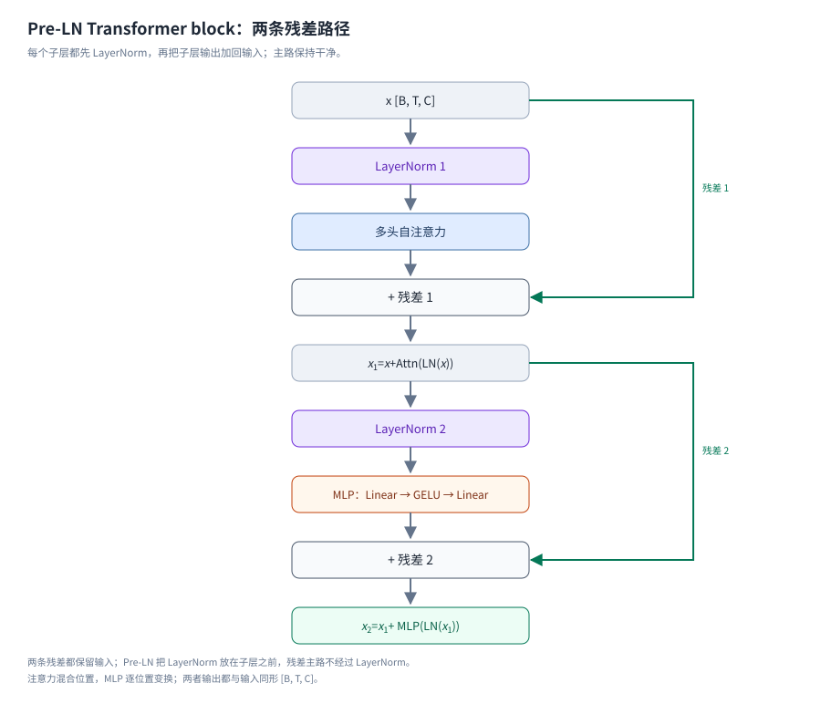
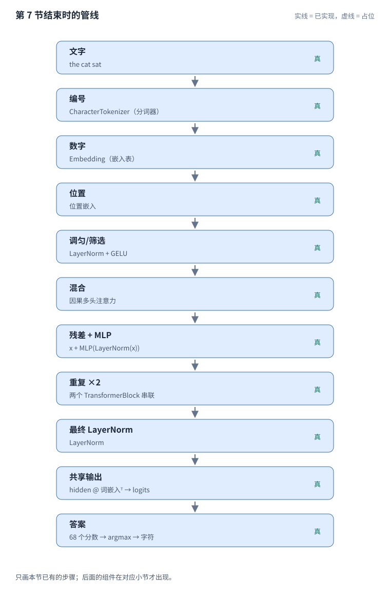

# 1.7 Transformer block 与整模型

1.6 结束时，管线里已经有一段因果多头自注意力：每个位置按权重读取前面的 $V$。但一个注意力层只负责“把别的位置的信息混进来”，它没有在每个位置上做足够的非线性变换，也没有把多层堆起来；模型最后还要把形状为 `[B, T, C]` 的隐藏状态（hidden state）变成形状为 `[B, T, vocab]` 的分数。

这一节把 1.5 的 LayerNorm、GELU 和 1.6 的注意力装成两层 **Transformer block**，再用共享的词嵌入输出分数。整模型有 5,824 个参数（parameter）；最后在最后一个位置取分数最高的编号，得到一个字符。

## 问题：一层注意力不够

1.6 的 `MultiHeadSelfAttention` 输入形状为 `[B, T, C]`，输出形状也是 `[B, T, C]`；它内部做 Q/K/V 投影、因果掩码、softmax 和加权求和，返回 `(output, cache)`。它解决的是“位置之间怎样交换信息”，但不解决“每个位置内部怎样把特征再加工一遍”。

如果只有注意力，每个位置的输出仍然是前面若干位置 $V$ 的线性组合；连续堆几层注意力，每层还是在做“按权重混合 $V$”。模型缺少一个逐位置的非线性子层，表达能力会受限。

第二个问题是深度。若一个子层写成 $F(x)$，模型只能不断替换 $x$；层数一多，原始信号和梯度都要穿过一长串变换。**残差连接**（residual connection）把输入直接加回输出：

$$
y = x + F(x)
$$

这条 $x$ 的通路不经过 $F$，形状仍是 `[B, T, C]`；它让深层网络至少能学到“什么都不改”，也给梯度一条短路径。第 3 章讲反向传播时会再展开这一点，本节先用这个直觉。

第三个问题是输出。1.3 用一张固定的 $W_{\text{out}}$ 把 16 维向量变成 68 个分数；如果这里再单独建一个 `Linear(C, vocab)`，就要多 1,088 个参数。词嵌入表本身已经是 `[vocab, C]`，可以反过来当输出矩阵用；这叫**权重绑定**（weight tying），也叫共享输入/输出嵌入。

## 思路：一个 block，两条残差子层

一个 **block**（块，也叫层块）由两个子层组成：先做注意力，再做 MLP（multi-layer perceptron，多层感知机）。每个子层都采用 **Pre-LN**（前置层归一化）：先把输入送进 LayerNorm，再进子层，最后把子层输出加回输入。

$$
\begin{aligned}
x_1 &= x + \operatorname{Attn}(\operatorname{LN}(x)) \\
x_2 &= x_1 + \operatorname{MLP}(\operatorname{LN}(x_1))
\end{aligned}
$$

这里 $x$、$x_1$、$x_2$ 的形状都是 `[B, T, C]`。注意力负责混合位置，MLP 负责逐位置变换；两条残差都保持形状不变。把这样的 block 串两层，就得到本章的深度。

图 1.7-1 和图 1.7-2 对比两种 LayerNorm 位置：

- **Pre-LN**：`x + Sublayer(LayerNorm(x))`；残差主路不经过 LayerNorm，主路干净。
- **Post-LN**：`LayerNorm(x + Sublayer(x))`；残差主路经过 LayerNorm，这是原论文的写法。

<div class="figure-pair">
<figure>

<figcaption>图 1.7-1：Pre-LN。归一化在子层之前，残差主路保持干净。</figcaption>
</figure>
<figure>

<figcaption>图 1.7-2：Post-LN。先加残差再归一化，残差主路经过 LayerNorm。</figcaption>
</figure>
</div>

本章采用 Pre-LN，原因是它更容易训练深：残差主路没有 LayerNorm，梯度可以沿着 $x$ 直接回传。Xiong 等人在 2020 年分析了两种顺序：Post-LN 在好的 warmup 下可以略好，但 Pre-LN 对初始化和学习率更稳；GPT-2 之后的很多 decoder-only 模型采用 Pre-LN。这个取舍在第 3 章训练时会再出现。

图 1.7-3 把 block 展开：$x$ 先过 LayerNorm 1 和注意力，再加回 $x$ 得到 $x_1$；$x_1$ 再过 LayerNorm 2 和 MLP，再加回 $x_1$ 得到 $x_2$。



*图 1.7-3：一个 Pre-LN block。注意力子层和 MLP 子层各有一条残差；两条主路都保持形状 `[B, T, C]`。*

### MLP：逐位置的非线性变换

**问题**：注意力只负责“按权重混合 $V$”。每个位置的输出仍然是若干 $V$ 的线性组合；即使堆几层注意力，模型还是没有对每个位置的特征做一次独立的非线性加工。只加一个 `Linear` 也不行：线性层叠线性层仍然是线性的；只加一个逐元素 GELU 也不行：GELU 不混合不同特征。

**思路**：给每个位置套一个相同的小型前馈网络（feed-forward network，FFN）：先把 $C$ 维特征扩大到一个更宽的隐藏层，做一次线性混合，经过 GELU 的非线性，再线性投影回 $C$ 维。扩大再压回（expand → nonlinear → project）给非线性留出空间；输出宽度仍是 $C$，所以能直接和残差相加。所有位置共用同一组权重，MLP 不在位置之间交换信息；位置混合仍然由注意力负责。

**做法**：MLP 是 `Linear → GELU → Linear`：

$$
\begin{aligned}
h &= \operatorname{GELU}(xW_1 + b_1) \\
y &= hW_2 + b_2
\end{aligned}
$$

其中 $W_1$ 的形状是 `[C, d_ff]`，$b_1$ 的形状是 `[d_ff]`，$W_2$ 的形状是 `[d_ff, C]`，$b_2$ 的形状是 `[C]`；$x$、$y$ 的形状都是 `[B, T, C]`。本章 $C = 16$、$d_{\text{ff}} = 32$，所以隐藏层每个位置有 32 个数字。

为什么是这两个 `Linear`：

- 第一个 `Linear` 把 $C$ 个特征混合并扩大到 $d_{\text{ff}}$；如果直接接 GELU，每个特征只被单独截断，不能组合不同特征。
- GELU 提供非线性；没有它，两个 `Linear` 合起来仍然是一个线性映射，MLP 就白加了。
- 第二个 `Linear` 把 $d_{\text{ff}}$ 压回 $C$；残差要求输出和输入同形，同时把隐藏层的组合投影回原来的特征空间。
- 扩大再压回给非线性留出容量；$d_{\text{ff}}$ 越大，能容纳的特征组合越多，参数也越多。本章 $d_{\text{ff}} = 32 = 2C$，MLP 有 1,072 个参数；标准 Transformer 常取 $4C$，本章取 $2C$ 是为了让 5,824 个参数和手算可控，设计思路不变。

注意 MLP 对最后一维逐位置作用，不混合位置；混合位置的只有注意力。两者交替，模型才能既“看别处”，又“加工自己”。

### 回顾：block 里复用的两个零件

1.5 的 `LayerNorm` 对最后一维 $C$ 求均值和方差，再乘 gain、加 bias；输入输出形状相同，本章每个 LayerNorm 有 $2C = 32$ 个参数。1.5 的 `GELU` 是逐元素非线性，没有参数。

1.6 的 `MultiHeadSelfAttention` 输入形状为 `[B, T, C]`，输出形状也是 `[B, T, C]`；它内部有 Q/K/V/out 四个 `Linear`，每个都是 `Linear(C, C)`，所以一个注意力有 $4(C^2 + C)$ 个参数。它返回的 cache 里有 q、k、v、weights，1.8 会用来做逐层展示。

用 $B = 2$、$T = 3$、$C = 4$、$d_{\text{ff}} = 8$ 走一遍形状：

- 输入 $x$ 的形状是 `[2, 3, 4]`；
- LayerNorm 后仍是 `[2, 3, 4]`；
- 注意力后仍是 `[2, 3, 4]`，加残差后 $x_1$ 是 `[2, 3, 4]`；
- MLP 先变成 `[2, 3, 8]`，GELU 后仍是 `[2, 3, 8]`，第二个 `Linear` 压回 `[2, 3, 4]`；
- 再加残差，$x_2$ 仍是 `[2, 3, 4]`。

## 做法：TransformerBlock

`TransformerBlock` 把两个子层和两条残差接起来。`forward` 先算 `norm1` 和注意力，得到 `hidden1`；再算 `norm2` 和 MLP，得到输出。cache 里保留中间量，供 1.8 逐层读取。

下面的代码按 `model.py` 的类定义讲；`MLP` 的完整定义在本小节末尾，`GPTConfig` 在下一小节；复制时把 `MLP` 和 `GPTConfig` 放在 `TransformerBlock` 前面。

```python
class TransformerBlock:
    def __init__(
        self,
        config: GPTConfig,
        *,
        generator: torch.Generator | None = None,
        dtype: torch.dtype = torch.float32,
    ) -> None:
        self.norm1 = LayerNorm(config.d_model, dtype=dtype)
        self.attention = MultiHeadSelfAttention(
            config.d_model,
            config.n_heads,
            generator=generator,
            dtype=dtype,
        )
        self.norm2 = LayerNorm(config.d_model, dtype=dtype)
        self.mlp = MLP(
            config.d_model,
            config.d_ff,
            generator=generator,
            dtype=dtype,
        )

    def forward(
        self, inputs: torch.Tensor
    ) -> tuple[torch.Tensor, dict[str, object]]:
        normed1 = self.norm1.forward(inputs)
        attended, attention_cache = self.attention.forward(normed1)
        hidden1 = inputs + attended
        normed2 = self.norm2.forward(hidden1)
        mlp_out = self.mlp.forward(normed2)
        output = hidden1 + mlp_out
        return output, {
            "norm1": normed1,
            "attention": attention_cache,
            "hidden1": hidden1,
            "norm2": normed2,
            "mlp": mlp_out,
        }

    def parameters(self) -> tuple[torch.Tensor, ...]:
        return (
            self.norm1.gain,
            self.norm1.bias,
            self.attention.q_proj.weight,
            self.attention.q_proj.bias,
            self.attention.k_proj.weight,
            self.attention.k_proj.bias,
            self.attention.v_proj.weight,
            self.attention.v_proj.bias,
            self.attention.out_proj.weight,
            self.attention.out_proj.bias,
            self.norm2.gain,
            self.norm2.bias,
            *self.mlp.parameters(),
        )
```

`MLP` 只是两个 `Linear` 夹一个 `GELU`：

```python
class MLP:
    def __init__(
        self,
        d_model: int,
        d_ff: int,
        *,
        generator: torch.Generator | None = None,
        dtype: torch.dtype = torch.float32,
    ) -> None:
        self.up = Linear(d_model, d_ff, generator=generator, dtype=dtype)
        self.gelu = GELU()
        self.down = Linear(d_ff, d_model, generator=generator, dtype=dtype)

    def forward(self, inputs: torch.Tensor) -> torch.Tensor:
        hidden = self.gelu.forward(self.up.forward(inputs))
        return self.down.forward(hidden)

    def parameters(self) -> tuple[torch.Tensor, ...]:
        return (
            self.up.weight,
            self.up.bias,
            self.down.weight,
            self.down.bias,
        )
```

一个 block 的参数：

- LayerNorm 1：$2C = 32$；
- 注意力：$4(C^2 + C) = 4 \times (16 \times 16 + 16) = 1,088$；
- LayerNorm 2：32；
- MLP：$C \times d_{\text{ff}} + d_{\text{ff}} + d_{\text{ff}} \times C + C = 16 \times 32 + 32 + 32 \times 16 + 16 = 544 + 528 = 1,072$。

合计 $32 + 1,088 + 32 + 1,072 = 2,224$ 个参数；两层 block 是 $4,448$。

## 输出层：logits 与共享嵌入

### 问题：C 维向量不能直接和词表比较

两层 block 之后，隐藏状态 $H$ 的形状是 `[B, T, C]`。模型要回答的是：在每个位置，词表里的 68 个 token 各自有多大的可能是下一个 token。一个 $C$ 维向量本身没有“词表”这一维，也没有把 68 个候选放在一起比较；它不能直接给出答案。

### logits：每个位置、每个候选 token 一个分数

对每个位置，把隐藏状态和词表中每个 token 的嵌入做点积，得到一个分数。所有这些分数排成一个新的最后一维，长度是 `vocab`：

$$
\text{logits} = HE^\top
$$

其中 $H$ 的形状是 `[B, T, C]`，$E^\top$ 的形状是 `[C, vocab]`，所以 logits 的形状是 `[B, T, vocab]`。第 $v$ 个 logit 是隐藏状态和词表中第 $v$ 个词嵌入的点积；分数越大，模型越倾向编号 $v$。

`logit` 这个词来自统计里的 log-odds；在深度学习里通常指 softmax 之前的原始分数。本书按后一种用法：logits 是每个候选 token 的实数分数，不要求非负，也不要求和为 1；它们还不是概率。

为什么形状必须是 `[B, T, vocab]`：

- `B`：批次里每条序列都有自己的预测；去掉 $B$ 会把不同序列混在一起。
- `T`：语言模型在每个位置都预测下一个 token；训练时每个位置都是样本，推理时才只取最后一个位置。
- `vocab`：每个位置要对 68 个候选分别打分；最后一维就是 argmax（取最大值的下标）和 softmax 作用的“候选轴”。

用本章的数字：$B = 2$、$T = 3$、$\text{vocab} = 68$ 时，logits 的形状是 `[2, 3, 68]`；取最后一个位置得到 `[2, 68]`，再对最后一维取 argmax 得到两个编号。单条序列 `the cat sat` 的 $T = 13$，所以形状是 `[13, 68]`；`logits[-1]` 是 `[68]`。

如果只输出 `[B, vocab]`，就只剩最后一个位置的预测，训练时其他位置的监督没有地方放；如果只输出 `[B, T]`，每个位置只有一个数，没法在 68 个候选之间比较。`[B, T, vocab]` 正好保留“哪条序列、哪个位置、哪个候选”三个维度。

### 权重绑定：复用词嵌入

最直接的做法是再接一个 `Linear(C, vocab)`；这个矩阵有 $16 \times 68 = 1,088$ 个参数，正好和 token 嵌入表一样大。

词嵌入表 $E$ 的形状是 `[vocab, C]`；把它转置得到 `[C, vocab]`，就可以当输出矩阵。于是输入查表和输出打分共用同一张 `[vocab, C]` 矩阵。

这就是**权重绑定**（weight tying）：输入查表和输出打分共用同一张 `[vocab, C]` 矩阵，省掉单独的 1,088 个输出参数；同时输入和输出落在同一个向量空间里。1.3 的固定 $W_{\text{out}}$ 在这里被这张共享矩阵替代，不再单独保留。

本章不需要把 logits 变成概率；只需要比较大小，所以可以直接取 argmax。训练时会在 logits 上做 softmax 和交叉熵，那是第 3 章的事。

## GPTConfig 与整模型

`GPTConfig` 把六个维度集中在一个不可变对象里，避免构造函数到处传数字：

```python
@dataclass(frozen=True)
class GPTConfig:
    vocab_size: int
    d_model: int
    n_layers: int
    n_heads: int
    d_ff: int
    max_seq_len: int
```

本章的取值：

|字段|值|含义|
|---|---|---|
|`vocab_size`|68|词表大小，也就是 `vocab`；输出 logits 的最后一维|
|`d_model`|16|每个位置的特征维 $C$；注意力、MLP、LayerNorm 的宽度|
|`n_layers`|2|TransformerBlock 的层数|
|`n_heads`|2|多头注意力的头数 $H$|
|`d_ff`|32|MLP 隐藏层的宽度|
|`max_seq_len`|16|位置表行数，也是上下文上限|

`TinyGPT` 负责把嵌入、两层 block、最终 LayerNorm 和共享输出串起来：

```python
class TinyGPT:
    def __init__(
        self,
        config: GPTConfig,
        *,
        generator: torch.Generator | None = None,
        dtype: torch.dtype = torch.float32,
    ) -> None:
        self.config = config
        self.token_embedding = Embedding(
            config.vocab_size,
            config.d_model,
            generator=generator,
            dtype=dtype,
        )
        self.position_embedding = Embedding(
            config.max_seq_len,
            config.d_model,
            generator=generator,
            dtype=dtype,
        )
        self.blocks: list[TransformerBlock] = [
            TransformerBlock(config, generator=generator, dtype=dtype)
            for _ in range(config.n_layers)
        ]
        self.final_norm = LayerNorm(config.d_model, dtype=dtype)

    def parameters(self) -> tuple[torch.Tensor, ...]:
        parameters = [
            self.token_embedding.weight,
            self.position_embedding.weight,
        ]
        for block in self.blocks:
            parameters.extend(block.parameters())
        parameters.extend((self.final_norm.gain, self.final_norm.bias))
        return tuple(parameters)

    def forward(self, token_ids: torch.Tensor) -> torch.Tensor:
        if token_ids.shape[-1] > self.config.max_seq_len:
            raise ValueError(
                f"sequence length {token_ids.shape[-1]} exceeds the model context "
                f"of {self.config.max_seq_len}"
            )
        positions = torch.arange(token_ids.shape[-1], device=token_ids.device)
        hidden = self.token_embedding.forward(
            token_ids
        ) + self.position_embedding.forward(positions)
        for block in self.blocks:
            hidden, _ = block.forward(hidden)
        hidden = self.final_norm.forward(hidden)
        return hidden @ self.token_embedding.weight.transpose(-1, -2)
```

`forward` 接受形状为 `[B, T]` 的编号（也接受单条序列的 `[T]`），返回形状为 `[B, T, vocab]` 的 logits。位置编号只有 `[T]`，会和 `[B, T, C]` 的 token 向量广播相加；批次维 `B`（1.4）只是把多条序列并排，不改变每个位置的宽度。

`forward_with_trace` 留到 1.8：它要返回每一步的中间量，接口和 cache 的键名会在下一节定下来。`parameters()` 返回一个扁平的张量元组；本章只数参数，`Parameter` 类和梯度缓冲第 3 章再加。

## 参数量：5,824

把四组参数相加：

|部分|计算|数量|
|---|---|---|
|token 嵌入|$68 \times 16$|1,088|
|位置嵌入|$16 \times 16$|256|
|两层 block|$2 \times (32 + 1,088 + 32 + 1,072)$|4,448|
|最终 LayerNorm|$2 \times 16$|32|
|共享输出|复用 token 嵌入|0|
|合计|$1,088 + 256 + 4,448 + 32$|5,824|

用 `parameters()` 验证：

```python
model = TinyGPT(
    GPTConfig(
        vocab_size=68,
        d_model=16,
        n_layers=2,
        n_heads=2,
        d_ff=32,
        max_seq_len=16,
    ),
    generator=torch.Generator().manual_seed(3),
)
assert sum(parameter.numel() for parameter in model.parameters()) == 5824
```

`parameters()` 不返回输出矩阵，因为输出矩阵就是 `token_embedding.weight` 的转置；如果把共享输出也算成独立参数，就会把同一张表数两遍。

## 前向与 argmax

对一条序列 `the cat sat`，编号长度是 13，模型返回形状为 `[13, 68]` 的 logits；最后一个位置的那一行是 68 个分数。取 **argmax** 就是答案编号：

$$
\hat y = \operatorname{argmax}_{v} \operatorname{logits}[T-1, v]
$$

`argmax` 只看大小，所以不需要先对 68 个 logits 做 softmax；softmax 是单调的，做与不做不会改变最大值的位置。

在 `ch01/end` 里运行：

```bash
uv run python scripts/show_placeholder.py --stage 7 "the cat sat"
```

输出：

```text
stage 7 | text: the cat sat
ids (13)        [66, 19, 7, 4, 52, 2, 0, 19, 52, 18, 0, 19, 67]
scores          68 | max 0.205 at 3
answer          3
character       'd'
```

这里的 `scores` 是最后一个位置的 68 个 logits；`max 0.205 at 3` 表示编号 3 的分数最高，`answer 3`，解码成字符 `'d'`。权重仍然是随机初始化的，这个答案没有语义；有意义的是形状、参数量和从 logits 到字符的过程。

## 本节结束后的管线



*图 1.7-4：第 7 节结束时的管线。两层 block 里各有注意力和 MLP；输出层复用词嵌入，最后 argmax。*

架构图把 block 画成一条线；图 1.7-3 展开了一个 block。实际运行时，`TransformerBlock` 重复两次，每次都有一个注意力子层和一个 MLP 子层；最终 LayerNorm 之后，隐藏状态乘词嵌入的转置，得到 68 个 logits。

## 验收

- `cd ch01/end && uv run pytest -q` 现在是 **38 passed**。
- `tests/test_structure.py::test_forward_shapes` 通过：`[2, 3]` 的编号得到 `[2, 3, 68]` 的 logits。
- `tests/test_structure.py::test_parameter_count` 通过：`parameters()` 一共 5,824 个数字。
- `tests/test_structure.py::test_last_position_logits_and_argmax` 通过：最后一个位置是 68 个分数，argmax 落在词表内。
- `tests/test_placeholder.py::test_stage_seven_returns_full_model_logits` 通过：stage 7 的分数等于模型的最后一个位置。
- `tests/test_placeholder.py` 的 stage 8 仍然是 `NotImplementedError`，留给 1.8。
- `uv run python scripts/show_placeholder.py --stage 7 "the cat sat"` 输出 `answer 3`、`character 'd'`。

## 扩展阅读：残差、Pre-LN 与深层 transformer

残差连接不是 transformer 发明的。2015 年，何恺明（Kaiming He）等人在 ResNet 里用 $y = x + F(x)$ 训练很深的卷积网络：如果某一层什么都不做，至少可以让 $F(x) = 0$，输出等于输入；这比让一整叠非线性层直接拟合恒等映射容易得多。残差还给出了一条从输出直通输入的短路径，反向传播时梯度不必穿过每一层。

2017 年的原始 Transformer 把残差和 LayerNorm 放在一起，但顺序是 Post-LN：先算子层，加残差，再 LayerNorm。这个结构在机器翻译上工作得很好；但层数一深，训练对学习率和 warmup 很敏感。2019 年 GPT-2 改用 Pre-LN：先 LayerNorm，再进子层，残差主路不经过归一化。Xiong 等人在 2020 年给出了分析：在合适的 warmup 下，Post-LN 的最终效果可以略好；但 Pre-LN 的优化更稳定，对超参数不那么敏感，因此更适合本章这种从零搭建、后面还要加训练循环的模型。

两种顺序的差别可以只用一句话记住：

- Pre-LN：$x + F(\operatorname{LN}(x))$，主路干净，梯度好走；
- Post-LN：$\operatorname{LN}(x + F(x))$，主路经过 LN，原论文的写法，深层要更小心地 warmup。

图 1.7-1 和图 1.7-2 画出了这两条路径。本章选 Pre-LN，不是因为 Post-LN 一定更差，而是因为它在“还没有调参经验”的第 1 章更稳；第 3 章真正训练时，这个选择会直接影响学习率和 warmup 的设计。

### 参考文献

- He, K.（何恺明）, Zhang, X.（张祥雨）, Ren, S.（任少卿）, & Sun, J.（孙剑）. (2016). *Deep Residual Learning for Image Recognition.* CVPR.
- Vaswani, A., et al. (2017). *Attention Is All You Need.* NeurIPS.
- Radford, A., et al. (2019). *Language Models are Unsupervised Multitask Learners.* OpenAI.
- Xiong, R., et al. (2020). *On Layer Normalization in the Transformer Architecture.* ICML.
