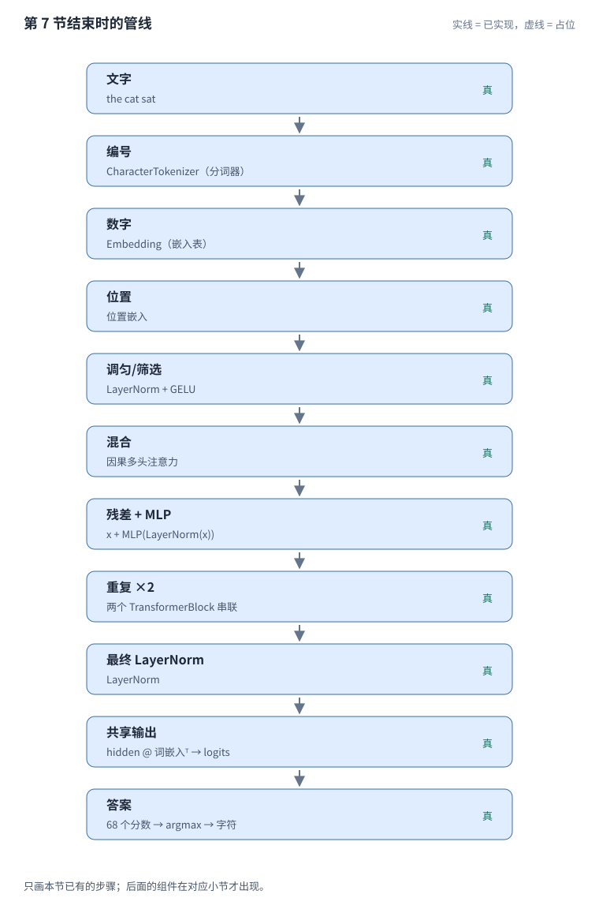

# 1.8 输出层与整模型

1.7 的 `TransformerBlock` 输入和输出都是形状为 `[B, T, C]` 的隐藏状态。一个 block 会混合位置、加工特征，但它还没有“词表”这一维，不能直接回答下一个 token 是谁；一个 block 也不是本章的完整模型。

这一节把两个 block 串起来，加最终 LayerNorm，再把隐藏状态变成形状为 `[B, T, vocab]` 的 logits；输出层复用 token 嵌入，整模型有 5,824 个参数；最后在最后一个位置取 argmax。

## 问题：block 还没有词表输出

1.7 的 block 输出 `[B, T, C]`。要回答“下一个 token 是谁”，模型必须在每个位置给 68 个候选分别打分；一个 $C$ 维向量没有词表这一维，也没有把候选放在一起比较。

此外，一个 block 只做一次注意力和一次 MLP；本章的模型要把这样的 block 叠两层，再在最后做一次 LayerNorm，才能得到完整的隐藏状态。最后还需要一个输出层，把 `[B, T, C]` 变成 `[B, T, vocab]`。

## 思路：两个 block + 一个输出层

整模型的前向可以写成：

```python
hidden = token_embedding.forward(token_ids) + position_embedding.forward(positions)
for block in blocks:
    hidden, _ = block.forward(hidden)
hidden = final_norm.forward(hidden)
logits = hidden @ token_embedding.weight.transpose(-1, -2)
```

- 两个 block 负责逐层混合位置、加工特征；
- 最终 LayerNorm 把最后的隐藏状态调匀；
- 输出层把 `[B, T, C]` 投影到 `[B, T, vocab]`，最后一维是候选 token；
- 输出矩阵与 token 嵌入共用，省掉单独的 1,088 个参数；
- 最后一个位置取 argmax，得到答案编号。

## 输出层：logits 与共享嵌入

### 问题：C 维向量不能直接和词表比较

两层 block 之后，隐藏状态 $H$ 的形状是 `[B, T, C]`。模型要回答的是：在每个位置，词表里的 68 个 token 各自有多大的可能是下一个 token。一个 $C$ 维向量本身没有“词表”这一维，也没有把 68 个候选放在一起比较；它不能直接给出答案。

### logits：每个位置、每个候选 token 一个分数

对每个位置，把隐藏状态和词表中每个 token 的嵌入做点积，得到一个分数。所有这些分数排成一个新的最后一维，长度是 `vocab`：

$$
\text{logits} = HE^\top
$$

其中 $H$ 的形状是 `[B, T, C]`，$E^\top$ 的形状是 `[C, vocab]`，所以 logits 的形状是 `[B, T, vocab]`。第 $v$ 个 logit 是隐藏状态和词表中第 $v$ 个词嵌入的点积；分数越大，模型越倾向编号 $v$。

`logit` 这个词来自统计里的 log-odds；在深度学习里通常指 softmax 之前的原始分数。本书按后一种用法：logits 是每个候选 token 的实数分数，不要求非负，也不要求和为 1；它们还不是概率。

为什么形状必须是 `[B, T, vocab]`：

- `B`：批次里每条序列都有自己的预测；去掉 $B$ 会把不同序列混在一起。
- `T`：语言模型在每个位置都预测下一个 token；训练时每个位置都是样本，推理时才只取最后一个位置。
- `vocab`：每个位置要对 68 个候选分别打分；最后一维就是 argmax（取最大值的下标）和 softmax 作用的“候选轴”。

用本章的数字：$B = 2$、$T = 3$、$\text{vocab} = 68$ 时，logits 的形状是 `[2, 3, 68]`；取最后一个位置得到 `[2, 68]`，再对最后一维取 argmax 得到两个编号。单条序列 `the cat sat` 的 $T = 13$，所以形状是 `[13, 68]`；`logits[-1]` 是 `[68]`。

如果只输出 `[B, vocab]`，就只剩最后一个位置的预测，训练时其他位置的监督没有地方放；如果只输出 `[B, T]`，每个位置只有一个数，没法在 68 个候选之间比较。`[B, T, vocab]` 正好保留“哪条序列、哪个位置、哪个候选”三个维度。

### 权重绑定：复用词嵌入

最直接的做法是再接一个 `Linear(C, vocab)`；这个矩阵有 $16 \times 68 = 1,088$ 个参数，正好和 token 嵌入表一样大。

词嵌入表 $E$ 的形状是 `[vocab, C]`；把它转置得到 `[C, vocab]`，就可以当输出矩阵。于是输入查表和输出打分共用同一张 `[vocab, C]` 矩阵。

这就是**权重绑定**（weight tying）：输入查表和输出打分共用同一张 `[vocab, C]` 矩阵，省掉单独的 1,088 个输出参数；同时输入和输出落在同一个向量空间里。1.3 的固定 $W_{\text{out}}$ 在这里被这张共享矩阵替代，不再单独保留。

本章不需要把 logits 变成概率；只需要比较大小，所以可以直接取 argmax。训练时会在 logits 上做 softmax 和交叉熵，那是第 3 章的事。

## GPTConfig 与整模型

`GPTConfig` 把六个维度集中在一个不可变对象里，避免构造函数到处传数字：

```python
@dataclass(frozen=True)
class GPTConfig:
    vocab_size: int
    d_model: int
    n_layers: int
    n_heads: int
    d_ff: int
    max_seq_len: int
```

本章的取值：

|字段|值|含义|
|---|---|---|
|`vocab_size`|68|词表大小，也就是 `vocab`；输出 logits 的最后一维|
|`d_model`|16|每个位置的特征维 $C$；注意力、MLP、LayerNorm 的宽度|
|`n_layers`|2|TransformerBlock 的层数|
|`n_heads`|2|多头注意力的头数 $H$|
|`d_ff`|32|MLP 隐藏层的宽度|
|`max_seq_len`|16|位置表行数，也是上下文上限|

`TinyGPT` 负责把嵌入、两层 block、最终 LayerNorm 和共享输出串起来：

```python
class TinyGPT:
    def __init__(
        self,
        config: GPTConfig,
        *,
        generator: torch.Generator | None = None,
        dtype: torch.dtype = torch.float32,
    ) -> None:
        self.config = config
        self.token_embedding = Embedding(
            config.vocab_size,
            config.d_model,
            generator=generator,
            dtype=dtype,
        )
        self.position_embedding = Embedding(
            config.max_seq_len,
            config.d_model,
            generator=generator,
            dtype=dtype,
        )
        self.blocks: list[TransformerBlock] = [
            TransformerBlock(config, generator=generator, dtype=dtype)
            for _ in range(config.n_layers)
        ]
        self.final_norm = LayerNorm(config.d_model, dtype=dtype)

    def parameters(self) -> tuple[torch.Tensor, ...]:
        parameters = [
            self.token_embedding.weight,
            self.position_embedding.weight,
        ]
        for block in self.blocks:
            parameters.extend(block.parameters())
        parameters.extend((self.final_norm.gain, self.final_norm.bias))
        return tuple(parameters)

    def forward(self, token_ids: torch.Tensor) -> torch.Tensor:
        if token_ids.shape[-1] > self.config.max_seq_len:
            raise ValueError(
                f"sequence length {token_ids.shape[-1]} exceeds the model context "
                f"of {self.config.max_seq_len}"
            )
        positions = torch.arange(token_ids.shape[-1], device=token_ids.device)
        hidden = self.token_embedding.forward(
            token_ids
        ) + self.position_embedding.forward(positions)
        for block in self.blocks:
            hidden, _ = block.forward(hidden)
        hidden = self.final_norm.forward(hidden)
        return hidden @ self.token_embedding.weight.transpose(-1, -2)
```

`forward` 接受形状为 `[B, T]` 的编号（也接受单条序列的 `[T]`），返回形状为 `[B, T, vocab]` 的 logits。位置编号只有 `[T]`，会和 `[B, T, C]` 的 token 向量广播相加；批次维 `B`（1.4）只是把多条序列并排，不改变每个位置的宽度。

`forward_with_trace` 留到 1.8：它要返回每一步的中间量，接口和 cache 的键名会在下一节定下来。`parameters()` 返回一个扁平的张量元组；本章只数参数，`Parameter` 类和梯度缓冲第 3 章再加。

## 参数量：5,824

把四组参数相加：

|部分|计算|数量|
|---|---|---|
|token 嵌入|$68 \times 16$|1,088|
|位置嵌入|$16 \times 16$|256|
|两层 block|$2 \times (32 + 1,088 + 32 + 1,072)$|4,448|
|最终 LayerNorm|$2 \times 16$|32|
|共享输出|复用 token 嵌入|0|
|合计|$1,088 + 256 + 4,448 + 32$|5,824|

用 `parameters()` 验证：

```python
model = TinyGPT(
    GPTConfig(
        vocab_size=68,
        d_model=16,
        n_layers=2,
        n_heads=2,
        d_ff=32,
        max_seq_len=16,
    ),
    generator=torch.Generator().manual_seed(3),
)
assert sum(parameter.numel() for parameter in model.parameters()) == 5824
```

`parameters()` 不返回输出矩阵，因为输出矩阵就是 `token_embedding.weight` 的转置；如果把共享输出也算成独立参数，就会把同一张表数两遍。

## 前向与 argmax

对一条序列 `the cat sat`，编号长度是 13，模型返回形状为 `[13, 68]` 的 logits；最后一个位置的那一行是 68 个分数。取 **argmax** 就是答案编号：

$$
\hat y = \operatorname{argmax}_{v} \operatorname{logits}[T-1, v]
$$

`argmax` 只看大小，所以不需要先对 68 个 logits 做 softmax；softmax 是单调的，做与不做不会改变最大值的位置。

在 `ch01/end` 里运行：

```bash
uv run python scripts/show_placeholder.py --stage 7 "the cat sat"
```

输出：

```text
stage 7 | text: the cat sat
ids (13)        [66, 19, 7, 4, 52, 2, 0, 19, 52, 18, 0, 19, 67]
scores          68 | max 0.205 at 3
answer          3
character       'd'
```

这里的 `scores` 是最后一个位置的 68 个 logits；`max 0.205 at 3` 表示编号 3 的分数最高，`answer 3`，解码成字符 `'d'`。权重仍然是随机初始化的，这个答案没有语义；有意义的是形状、参数量和从 logits 到字符的过程。

<figure>

<figcaption>图 1.8-1：完整前向的样例。ids → 嵌入 `[13,16]` → block 0 → block 1 → final LayerNorm → logits `[13,68]` → 最后一个位置 argmax 3 → `'d'`。</figcaption>
</figure>

## 本节结束后的管线



*图 1.8-2：第 8 节结束时的管线。两层 block 里各有注意力和 MLP；输出层复用词嵌入，最后 argmax。*

架构图把 block 画成一条线；图 1.7-3 展开了一个 block。实际运行时，`TransformerBlock` 重复两次，每次都有一个注意力子层和一个 MLP 子层；最终 LayerNorm 之后，隐藏状态乘词嵌入的转置，得到 68 个 logits。

## 验收

- `cd ch01/end && uv run pytest -q` 现在是 **40 passed**。
- `tests/test_structure.py::test_forward_shapes` 通过：`[2, 3]` 的编号得到 `[2, 3, 68]` 的 logits。
- `tests/test_structure.py::test_parameter_count` 通过：`parameters()` 一共 5,824 个数字。
- 1.7 的 `test_block_shapes` 和 `test_block_parameter_count`（2,224）也通过。
- `tests/test_structure.py::test_last_position_logits_and_argmax` 通过：最后一个位置是 68 个分数，argmax 落在词表内。
- `tests/test_placeholder.py::test_stage_seven_returns_full_model_logits` 通过：stage 7 的分数等于模型的最后一个位置。
- `tests/test_placeholder.py` 的 stage 8 仍然是 `NotImplementedError`，留给 1.9 的逐层 trace。
- `uv run python scripts/show_placeholder.py --stage 7 "the cat sat"` 输出 `answer 3`、`character 'd'`。

## 扩展阅读：权重绑定

输入词嵌入和输出分类器共用一张矩阵，最早是为了减少参数。2017 年，Press 与 Wolf 在语言模型里系统比较了这种做法：输出层直接复用输入嵌入的转置，参数更少， perplexity 往往不降反升；同年 Inan 等人也把词向量和分类器绑定，发现小模型上收益更明显。原因不难理解：输入和输出本来就在描述同一批 token，让它们共享一个向量空间，相当于给每个 token 一个统一的“输入坐标”和“输出方向”。

本章的输出层就是这样：$E$ 的形状是 `[vocab, C]`，输入查表用 $E$，输出打分用 $E^\top$。如果单独建一个 `Linear(C, vocab)`，会多 1,088 个参数，而且输入和输出可能学到两套不一致的 token 表示。权重绑定让它们共用一套表示，参数从 6,912 降到 5,824。

当然，绑定不是没有代价：输入嵌入要同时满足“查表”和“分类”两个角色，容量被共享；有些模型在输出层加一个独立的 bias，或者只绑定部分维度。本章为了小和清楚，采用完全绑定、无输出 bias 的版本。

### 参考文献

- Press, O., & Wolf, L. (2017). *Using the Output Embedding to Improve Language Models.* EACL.
- Inan, H., Khosravi, K., & Socher, R. (2017). *Tying Word Vectors and Word Classifiers: A Loss Framework for Language Modeling.* ICLR.

